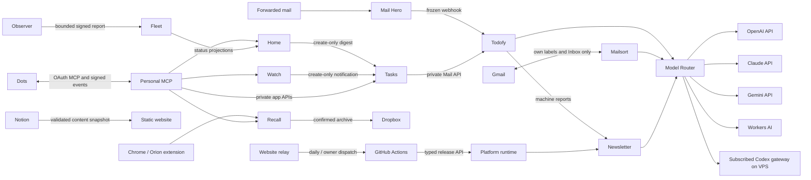

# Service boundaries

One repository manages Cloudflare applications, a static website, browser extensions and the VPS's k3s workloads.
The [service catalog](service-catalog.md) owns inventory/presentation; application configs and code own behavior.
[HANDOFF](../HANDOFF.md) distinguishes released facts from current work. This page describes the committed design,
not a live production check.

## Data and communication

Each app owns its storage and behavior. Apps do not import another app's implementation, configuration or test tools.
Cross-app traffic uses declared proto APIs/events/service bindings. Only these directories provide shared code:

| Directory | Responsibility |
| --- | --- |
| `proto/` | IDL, generated types, wire codecs, HTTP transcoder/client |
| `contracts/` | Consumer semantics, generated schemas, dependency-free rules and frozen compatibility fixtures |
| `packages/` | Shared auth, planning UI, dates and model clients, compiled into actual users |
| `tools/` | Build, test, configuration and operator tooling; never imported by shipped app source |

Bazel libraries and root check/release facades declare actual dependencies. The [CI graph](ci-cd.md) follows those
edges rather than maintaining a second path-to-consumer map. Third-party resolution stays in the existing locks.

## Interfaces and compatibility

Owner APIs use root proto descriptors, typed clients/transcoders and the wire JSON profile. Authentication and
mutation Origin/CSRF checks happen before body reads. Pages are bounded/indexed; raw attachment/blob streams remain
outside JSON transcoding under the same authentication and private response rules.

Fleet's owner API is read-only. Machine interfaces have their own narrow authentication; they never inherit owner
permissions implicitly. Personal MCP uses the official managed-OAuth MCP handler and native private app clients.
Platform accepts frozen typed workload/image/release identities, not commands, YAML, arbitrary paths or URLs.

Golden bytes and legacy fixtures prove compatibility with persisted events and restored data; they are not obsolete
because routes moved to proto. Keep the [dated old-client windows](history.md#owner-api-compatibility). Historical
column/event/resource identities remain stable even when their display or current owner changes.

## Tasks and planning

Tasks owns task/project/label/filter content, history, planning facts/dependencies, Plan, Goals, Focus, timers and GTD.
Its desktop PWA reads generated APIs and bounded pages, with details loaded on demand. It has no bidirectional
Todoist writes; the old account is a migration source.

Todofy keeps mail/summary data. Tasks reads its private Mail entry and creates a task only on explicit conversion.
Home and Watch use create-only TaskInbox with their own source identities. Personal MCP uses its declared generic
Tasks API access. A drag into a day changes the execution queue, not the real due date or Deadline.

Planning components/date rules are packages, not services. The [Tasks design](../tasks/docs/design.md),
[import](../tasks/docs/import.md) and [backup](../tasks/docs/backup.md) own task semantics and recovery.

## Home

Home is a launcher and content-free operations view, not a second administrator of app storage. It uses registered
Ops/service bindings, fixed public probes and bounded platform metadata. HomeState performs scheduled observation,
canary/digest, usage and drift work; the edge Worker forwards pre-encoded views with the existing caching rules.

It never reads app D1/R2, private configuration or business bodies. Fleet projects VPS/Newsletter/Codex status; Home
does not SSH to the VPS. Website reachability and content-sync evidence are separate observations. Missing, stale
or failed observations do not inherit a previous success as current health.

Refresh/drift/probes have explicit request budgets. Guarding affects only supported deferrable work, expires, and
preserves manual overrides. Alerts can be dismissed per occurrence; dismissal neither fixes state nor authorizes
replay. The daily digest creates at most its own bounded task through TaskInbox.

The synthetic mail canary proves Mail Hero delivery through Todofy processing, not source forwarding, Email Routing
or MIME receipt. It creates no task/report/real summary and stays outside business counters. Source durable acceptance,
model success, provider mail acceptance and actual inbox delivery remain distinct.

Current UI, storage/job details and quotas are owned by [Home docs](../dashboard/README.md), not copied here.

## Application detail

| Application | Authority and important boundary |
| --- | --- |
| Mail Hero | One-address ingress, private R2 mail, D1 lifecycle and DO alarms. Retries preserve frozen event bytes/identity/target. Native daily backup; no VPS collector. |
| Todofy | Thin TS gateway and private Python DO, the ledger's only writer. Model Router calls, retained summaries and machine reports; no task creation. |
| Tasks | Native task/planning store and PWA, bounded private APIs, TaskJobs scheduling and its own backup. |
| Links | Public/private short links and owner launcher. Anonymous resolve is one primary-key read, zero writes/logs, 302/no-store; no enumeration. Independent backup Alarm. |
| Watch | SQLite DO and private evidence R2, no model judgment. Stored rendered/text/screenshot evidence goes to Dots. Notifications contain only permitted metadata, never watched text/URL. |
| Mailsort | Existing Gmail grant, own labels/Inbox only, one maintained prompt through Router. No mark-read/send/delete. Bounded recent intake, modes/write ledger and independent backups. |
| Recall | Multi-device extension intake, visit/index state and retained text/screenshots. Files leave Cloudflare only after confirmed Dropbox archive. Machine tokens are route-scoped digests. |
| Storage | Shared HTTP object access to a separate Dropbox App folder. Application credentials select a fixed namespace; content streams and conditional writes preserve independent consumers. Dropbox authorization belongs only to Storage. Existing Recall archives remain independent. |
| Model Router | Unified model API, supplier connections, usage/estimates, D1 metadata and retained private R2 bodies. Apps retain their prompts, budgets and workflows. |
| Personal MCP | Work continuation, private app tools and event subscriptions in one DO. Bounded references/deliveries, no source-content database or server model. Callback acceptance is not Dot completion. |
| Newsletter | Independent persistent VPS workflow, own SQLite and frozen send ledger; Notion is async backup. Models through Router, external legacy engine proto remains locked. |
| Newsletter console | Read-only Worker/UI over the engine's owner-authenticated bounded listener; no storage or execution controls. |
| Platform | Typed k3s release/status daemon with persistent release checkpoints, namespace/image allowlists and explicit held-release resume. |
| Fleet | Read-only owner view of bounded signed observations, histories and release provenance; never proxies deployment commands. |

Application READMEs link the actual contracts, security rules, backup/restore and verification records.

## Website

Visitors receive static assets; no visitor path calls Notion. The relay owns the daily clock and Home's manual sync
request. GitHub reads a complete validated snapshot and publishes only when identity changes. The workflow has no
second schedule or Notion button/writeback requirement.

A prepared snapshot is an explicit Bazel input. Publication preserves the green-source gate, content checks,
artifact/browser/live route identity, Deployment records and rollback. Content/media never enter Git. Code identity
follows the source/build closure, independently of unrelated application commits.

The committed config owns the complete Custom Domain set; `www` is canonical and the apex serves the same static
site. The dedicated certificate boundary is explained in [Website architecture](../website/docs/architecture.md).
The retired apex Worker does not return. Root MX/TXT/DKIM remain outside unrelated website changes.

## Configuration and deployment ownership

`config/cloud.toml` is the public deployment profile; `config/resources.toml` records actual identities. Generators
materialize declared public fields only. Each committed Wrangler file is the sole Worker production source; wrappers
inject private values, operational switches and source identity. Provider model keys stay only in Router.

OpenTofu owns its declared Access/storage/IdP/Email Routing/Platform Tunnel resources. Wrangler owns Worker code and
routes. External tunnels/DNS and the root mailbox stay outside that scope. [Rebuild](rebuild.md) separates necessary
account/OAuth/bootstrap steps from ordinary push-to-publish operation; [verification](rebuild-verification.md) marks
existing-environment versus unperformed fresh-account/history-restore exercises.

K3s workloads use independent image digests, standard manifests and namespace-scoped permissions. The observer uses
bounded read-only metadata; an in-cluster observer stopping cannot independently diagnose a lost node. Unreadable
state remains unknown. Runtime allowlists and physical provenance remain separate from business delivery success.

Actions holds no SSH key or Kubernetes admin credential. It invokes the bounded daemon API, waits for ready and fresh
physical evidence, and records actual success. Repair uses the accepted release, etag/plan fingerprint and a separate
drain transaction; a clean check does not restart Pods. Secrets, PVCs, ledgers, pauses and existing resource identities
are preserved. Host-entry recovery uses the reviewed bootstrap flow, not a general remote command API.
