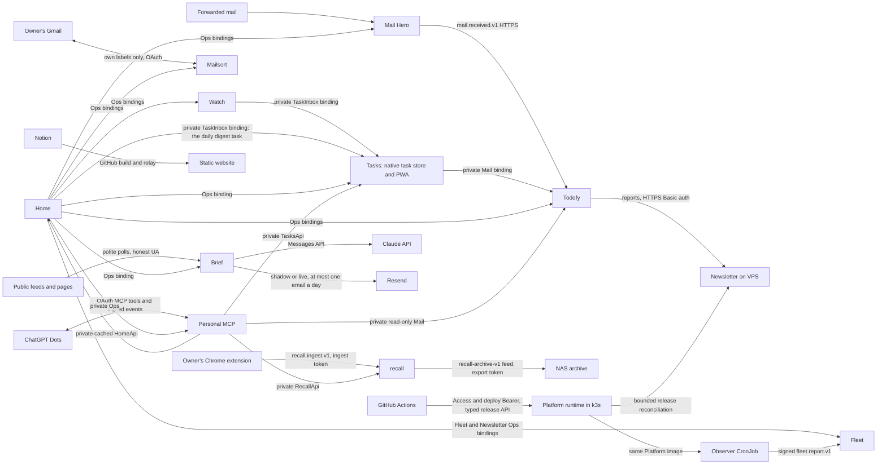

# Service boundaries

The repository manages Cloudflare applications and the VPS's k3s image workloads from one source tree.
The [service catalog](service-catalog.md) is the application inventory; it also distinguishes Cloudflare
Workers, VPS image repositories and browser extensions. [HANDOFF](../HANDOFF.md) records deployment evidence and what remains
unverified. This page describes the committed architecture, not a fresh production check. Development
entry points are in the [root README](../README.md).

## Data and communication

No application imports another application's code, configuration or test tools. Shared code follows these boundaries:

| Home | Responsibility | Production boundary |
| --- | --- | --- |
| `proto/` | IDL, generated types, wire JSON codecs, HTTP transcoder/client | Compiled into each actual user; generated directories are not committed |
| `contracts/` | Consumer semantics, schemas, golden fixtures and dependency-free value rules | Only explicitly mapped runtime files are bundled |
| `packages/edge-auth/` | Access JWT, signed double-submit CSRF, private headers | Compiled via `file:` dependency; Web Crypto, no runtime dependencies |
| `packages/planning-ui/` | Existing Plan, Focus and Mail components | Compiled into Tasks; typed transports and navigation callbacks |
| `packages/task-dates/` | Date previews and recurrence advancement | Compiled into Tasks; reused by its explicit import tool |
| `tools/` | Tests, builds and deployment checks | Never imported by production application source |

`PACKAGE_USERS`, `PROTO_USERS`, `PROTO_PACKAGES` and `BUNDLED_BY` in
[ci_changes.py](../.github/scripts/ci_changes.py) are checked against actual imports/dependencies.
`edge-auth` and each language's proto runtime are compiled into their checked consumers. Todofy uses both
language runtimes; Platform uses the shared Python runtime for its API and observer reports, and Fleet
uses the TypeScript descriptions of those reports. The website has neither shared contract nor shared
runtime. Newsletter keeps its own locked container dependencies and existing external wire runtime.

## Interfaces and compatibility

| Application | Owner IDL | Path prefix |
| --- | --- | --- |
| Mail Hero | `mailhero.ui.v2` | `/api/v2/` |
| Todofy | `todofy.ui.v1` | `/api/v1/` |
| Tasks | `tasks.ui.v1` | `/api/tasks/v1/` |
| Home | `dashboard.ui.v1` | `/api/v1/` |
| Links | `links.ui.v1` | `/_/api/v1/` |
| Watch | `watch.ui.v1` | `/api/v1/` |
| Mailsort | `mailsort.ui.v2` | `/api/v2/` |
| recall | `recall.ui.v1` | `/api/v1/` |
| Brief | `brief.ui.v1` | `/api/v1/` |
| Fleet | `fleet.ui.v1` | `/api/v1/` |

The [proto HTTP pattern](../proto/README.md#http-apis) owns route descriptors, request/response types and
Google RPC errors. Browser owner APIs authenticate before body reads and require Origin/CSRF checks for
mutations. Fleet's owner API is read-only; its separate exact receipt path accepts only authenticated
machine reports. Lists are bounded, paged through indexes, and budgeted on the isolate's first request;
Mail Hero and Tasks warm up their heaviest codec/query paths.
Todofy's gateway sends decoded wire JSON over `COORDINATOR.owner_ui` to the Python object, which reads it
strictly and returns a generated response. The gateway reads that response and writes the wire JSON again.

Mail Hero's raw/attachment byte streams stay outside the transcoder under the same authentication and
`no-store`/`nosniff`/Content-Disposition headers. Its two heavy reads run the same transcoder in its DO,
which also streams attachment bytes. Its backup machine API is a separate surface. Todofy's webhook,
reports and health retain their transport, paths and authentication in
[machine-api-v1.openapi.yaml](../todofy/api/machine-api-v1.openapi.yaml).

recall's three machine routes under `/api/machine/v1/` sit outside its owner API: the extension's uploads
(`recall.ingest.v1`, an ingest token) and the archive consumers' change feed and blobs
([recall-archive-v1](../contracts/recall-archive-v1/README.md), an export token). An Access Bypass application lets
exactly these paths through, and the Worker checks each route's own token digest before any object call.

Platform's separate `platform.runtime.v1` machine API owns bounded node/workload reads and persisted
Create/Get/Resume release operations under `/api/v1/`. Actions sends frozen workload keys, source SHA,
image digests and request identity; it cannot send commands, YAML, paths or arbitrary URLs. Public
deployment requests pass Cloudflare Access and an independent Bearer check before body decoding.
Namespace, image repository and resource allowlists come from the daemon's mounted configuration.
See the [runtime contract](../contracts/platform-runtime-v1/README.md).

Personal MCP's `/mcp` is the external MCP 2.0 protocol, handled by the official SDK after Access's managed OAuth
and owner verification. Its private bindings reuse generated Tasks/Mail/Recall HTTP clients and the typed
`dashboard.mcp.v1.HomeService`; they do not pass through browser login or introduce public source routes.
The existing SQLite subscription DO checks only subscribed event sources each minute and stores metadata,
cursor progress and frozen deliveries. It does not own business content or call a model. Home observes its
private Ops status, while MCP's cached Home event reader excludes its own issues to avoid a notification loop.
Tools, GTD rules and event payloads are in [Personal MCP](../personal-mcp/README.md).

Schemas generated from IDL are consumer artifacts, not competing handwritten sources. Golden payloads pin
published bytes, while legacy fixtures/schemas prove compatibility with persisted older events. Do not delete these
because the owner APIs moved to proto. (`task-intent-v1`, the last contract with handwritten value rules, was retired
on 2026-10-21.) Dated old-owner routes are listed in [history](history.md#owner-api-compatibility).

## Tasks and planning

`tasks/` owns the native task store and installable desktop PWA: tasks, project hierarchy, sections, labels,
filters, scheduled dates, deadlines, recurrence and completion history live in its D1 database. The web app
uses the generated `TasksUiService`; full task details load on demand and lists use bounded indexed pages.
The PWA provides an offline notice and uses task data online.

Plan, Focus and Mail reuse `packages/planning-ui`. Planning is Tasks' own: each task's stage, area, start-ahead
days, flags and dependencies are task fields under its one etag, and GetPlan reads the weekly goals, the Review
lane orders and next week's commitments (`proto/tasks/ui/v1/plan.proto`). The Mail page reads mail through Tasks'
private `MAIL` binding to Todofy's Mail entry (`todofy.mail.v1`); Tasks converts a mail into a task itself and keeps
the Mail category shortcuts, the GTD counts and the Sunday review (its `TaskJobs` Durable Object). Todofy writes no
task. Focus's day queues, timer and time records are Tasks' own
(`proto/tasks/ui/v1/focus.proto`): a day drag is one Tasks `MoveFocusStep`, and a task completion settles its
Focus day and a related timer in the same Tasks write. A task's estimate is its Tasks duration.

Tasks reads the weekly rollover as a rule rather than a job: a commitment is for its week, and once that week ends
it reads as a weekly candidate with no write. Counts stay soft limits. Todofy retains mail receipts, summaries and
the mail inbox, and serves no planning; migration `0013_drop_plan_store.sql` dropped its old planning tables. Mail
filing uses the native Inbox, with an optional category's label and priority. Home and Watch create tasks only
through Tasks' create-only `TaskInbox` (`proto/tasks/inbox/v1`), each under its own `source`.
The task UI replaces technical planning labels and favorites with those controls while retaining their underlying
identities.

Imported task IDs preserve mail references.
Tasks is the only task store: no code reads or writes Todoist, and the original account remains intact as the
migration source. See [Tasks design](../tasks/docs/design.md), [import and cutover](../tasks/docs/import.md)
and [verification](../tasks/docs/verification.md).

## Home

Home is the owner launcher and operations console, not a second administrator of each application's storage.
It calls only generated Ops methods through `MAIL_HERO`, `TODOFY`, `TASKS`, `WATCH`, `MAILSORT`, `RECALL`, `BRIEF`, `FLEET`,
`NEWSLETTER` and `WEBSITE_SYNC` bindings. `FLEET` targets Fleet's `Ops`; `NEWSLETTER` targets its `NewsletterOps` projection of the latest
bounded host report. Home does not call the VPS directly or read an application's D1, R2, private
configuration or source. The four views are Home, Flows, Cloudflare and Ops.

`BRIEF` targets Brief's `Ops`: bounded counts, costs, budget and signal codes, with no issue text or source URLs.
Its guard defers embedding, learning and source probes. Brief and Home deploy at the same source SHA, with Home
waiting for Brief; the integration's rollout evidence is in [HANDOFF](../HANDOFF.md).

Fetch/cron handlers authenticate, route and make one RPC; the SQLite `HomeState` owns the work. It serializes
each view once and the Worker forwards `PreEncoded` bytes with ETag/304, avoiding another decode/encode under
the ordinary Free request's 10 ms CPU limit. Wire conformance tests pin this property. Refresh is an
authenticated mutation (`POST /api/v1/homeView:refresh`), not a GET query parameter.

Bounded work remains mandatory:

- Each tick makes at most one `status()` call per application and one GraphQL usage query.
- The private configuration-drift check uses at most 12 read-only GETs per tick, finishes about every UTC day,
  and discards values while keeping binding names/types. Desired state is generated from the committed Wrangler
  files and deploy wrappers; a configuration change regenerates it in the same commit.
- Owner refresh is fetched at most once per minute. DO history is bounded; canary history lasts 60 days.
- `CF_ANALYTICS_TOKEN` goes only as Bearer to fixed read-only endpoints under
  `https://api.cloudflare.com/client/v4`. Least-privilege scopes and setup are in [setup §4](../dashboard/docs/setup.md).
- Drift names/results stay in HomeState and the Access-protected UI, never in public issues, artifacts or logs.
  Only counts enter the daily ops report.
- Usage at 80% of a daily allowance or monthly R2 operation allowance applies shed; below 70% or a new UTC day
  clears it. Shed expires and delays only explicitly deferrable work, never real-mail handling.
- Reminders go only through the digest's own task (`TASK_INBOX.createInboxTask`), at most one per UTC day; Mail
  Hero's `ALERT_WEBHOOK_URL` stays unconfigured.
  Quota numbers cite Cloudflare and match [limits](../dashboard/docs/limits.md).

The synthetic mail canary covers Mail Hero intake/delivery and Todofy model processing. It does not create
tasks, newsletters, summaries or reminders and does not count as real mail. Mail Hero's delivered state
means consumer durable acceptance; Todofy's later task success is a separate stage.

Fleet's receipt API uses the versioned [fleet-report-v1 contract](../contracts/fleet-report-v1/README.md)
and an independent HMAC key; its SQLite DO validates and persists bounded status snapshots. Ops remains
service-binding-only. Reports contain stable workload/node aliases, counts and shared runtime release
status, never administrative kubeconfig, raw Kubernetes objects, secrets, content or logs. Desired target,
physical image/process provenance, fresh observation and business health remain distinct. Neither an
accepted report nor a ready deployment receipt proves successful Newsletter delivery.

## Application detail

- **Mail Hero:** Email Routing to one configured address, private raw mail in R2, D1 lifecycle ledger and
  SQLite DO alarms. Persistent retries resend the same frozen event identity/bytes/endpoint revision.
  [AGENTS](../mail-hero/AGENTS.md) and [setup](../mail-hero/docs/cloudflare-setup.md) govern storage, budget,
  backup leases, deletion and recovery. The backup collector image is separate from the Worker.
- **Todofy:** TypeScript gateway plus Python SQLite DO core, the ledger's only writer/scheduler. Mail receipts,
  summary work and reconciliation use distinct durable states; it writes no task since 2026-10-21. See the
  [development invariants](../todofy/docs/dev-notes.md) and [gateway contract](../todofy/docs/gateway-contract.md).
- **Tasks:** primary task content and completion history in D1, with the owner-only desktop PWA and private
  consumer bindings. Planning and date code are shared packages, not additional services. See the
  [design](../tasks/docs/design.md) and [migration runbook](../tasks/docs/import.md).
- **Links:** public short links and an owner launcher under `/_/`. A redirect does one primary-key D1 read,
  zero writes/logs, and uses 302 only. A private key and a nonexistent key give anonymous callers the same
  response. Only `/_` and `/_/*` are behind Access. See [AGENTS](../links/AGENTS.md).
- **Watch:** one SQLite DO, no D1/R2 and no cron. Its exact fetch/redirect/robots/size/time budgets and URL
  refusals are in [AGENTS](../watch/AGENTS.md). Tests use synthetic sites. Notifications freeze TaskInbox requests,
  include only owner-created names, trigger types/counts and app links, and never include page text or watched
  URLs. One digest after 14:00 UTC plus at most nine urgent tasks keep to its own budget of ten a day (TaskInbox
  refuses a source's 21st).
  BROKEN and automatic pauses enter the digest; status/guard reach Home through Ops.
- **Mailsort:** one SQLite DO, no D1/R2 and no cron, plus the Workers AI binding (Clef, Clef-flash, bge-m3). It
  reads the owner's Gmail with the owner's own OAuth grant and only ever adds or removes its own labels (created by it
  or adopted, owned by ID) and INBOX, through the closed operation table of `gmail.ts`; it never marks mail read, deletes, sends or changes
  settings. Every write is a ledger row first and can be undone. Shadow mode (the default) only records; the
  deployment variable `MODE` and the breaker can only lower the mode. The Gmail grant is put by the owner and never
  passes through GitHub. See [AGENTS](../mailsort/AGENTS.md) and [design](../mailsort/docs/design.md).
- **recall:** one SQLite DO (records, the bigram FTS5 index, the compacted change feed) and one private R2 bucket (the
  texts of a rolling retention window, a year by default; a text leaves only after the Dropbox archive confirmed it), no
  D1 and no cron. A Chrome extension (never in incognito) records visits with their focus time and a page's
  text after ten seconds; both it and the Worker scrub secrets and apply the denylist with the same `recall/shared/`
  code, and sensitive sites are kept by their site alone. Logs never hold a URL, title or text. The machine tokens are
  made in its 设置 and kept as digests. Its alarm writes the archive (`contracts/recall-archive-v1`) into the owner's
  Dropbox app folder (OAuth with PKCE, connected in 设置), which the NAS syncs with its own Dropbox support: nothing of
  recall's runs on the NAS. Its Access applications and bucket exist since 2026-10-10 and CI deploys it like any app;
  Home binds its Ops entrypoint. See [AGENTS](../recall/AGENTS.md) and [design](../recall/docs/design.md).
- **Brief:** one SQLite DO that schedules itself with alarms (no D1, R2 or cron), plus the Workers AI binding (bge-m3
  only). It fetches the registry's public feeds and pages itself (an honest user agent, per-host pacing, never a
  paywall or a login), screens with Claude Haiku, picks and writes with Claude Opus through the official SDK (the only
  caller is `claude.ts`), checks every quote and number in code, and sends at most one email a day through a ledger
  (`send.ts`; an unknown outcome is never sent again). The Claude and Resend keys are put by the owner and never pass
  through GitHub; `BRIEF_MODE` and 暂停 can only lower what it does. Its first deployment (`7bea3ec`) runs in archive
  mode: public-source fetching and paid Claude calls can run, with no email sent. Home monitors its Ops entrypoint;
  resource registration and Home rollout acceptance are tracked in [HANDOFF](../HANDOFF.md). See
  [AGENTS](../brief/AGENTS.md) and [design](../brief/docs/design.md).
- **Newsletter:** runs as an independent k3s image because its workflow uses Codex CLI. It reads Todofy's machine
  reports through existing HTTPS/Basic auth and keeps its own persistent state. It does not import Todofy's
  implementation. Its external `ziyixi-protos`/wire JSON runtime and private drain/monitor adapters stay intact.
  A daily CronJob owns the schedule; config-sync independently downloads validated editorial bundles. Its
  [README](../newsletter/README.md) governs business checks. CI publishes the catalog's immutable Newsletter
  image, paired with an independently tested Platform image of the same source SHA for a VPS release.
- **Platform:** the k3s Deployment exposes the shared-proto release/status API. A SQLite ledger persists frozen
  release targets and drain/apply/verify/resume checkpoints across its own image replacement. It reconciles only
  configured workloads through namespace-scoped Kubernetes permissions. API acceptance starts work; Actions
  waits for ready and fresh physical/process evidence. Held releases require an explicit resume or recovery.
- **Fleet:** an Access-protected, read-only Worker/UI and SQLite DO receive reports and expose k3s, release,
  system-unit and Newsletter status. The observer is a `*/5` CronJob with `Forbid` concurrency, the same Platform
  image, a separate state PVC and a projected read-only service account. It has no host PID/network, privileged
  mode or Docker socket. Exact read-only mounts provide host meminfo and the system D-Bus socket; Jeepney reads
  only fixed units' properties. A read-only socket mount does not restrict D-Bus method permissions: the
  container UID must have no host polkit grant to manage units. Unreadable evidence is unknown. Since the
  observer runs inside k3s, a cluster outage yields a stale/missing report rather than an independent live host
  diagnosis. Fleet never proxies deployment commands.

## Website

Visitors read a Next.js static export served as Worker assets; no application request code reads Notion.
The Notion relay handles buttons and a 15-minute change detector. Its release workflow checks hourly
10:30–15:30 UTC for a missing daily reconcile, using the same gate/quiet period/concurrency as the relay;
the schedule only dispatches the release, and does not itself publish.

Publication uses `website-release.yml` and concurrency group `website-production`, whether started by CI,
Notion, schedule or a manual dispatch. GitHub Deployments (`website-release`) record the release identity.
Keep the gate, identity comparison, local/browser verification, live verification and rollback intact.
Notion content/media never enter source, and relay logs contain only result codes/counts.

The website's complete Custom Domain set is in `website/wrangler.toml`: `www.ziyixi.science` is canonical and
the apex serves the same site. Their dedicated shared certificate must not cover application hosts; the
[Hostnames explanation](../website/docs/architecture.md#hostnames) records the browser connection-coalescing issue.
The apex redirect Worker/routes are retired. Root MX/TXT/DKIM are protected and unrelated to site publishing.
See [release](../website/docs/release.md) and [architecture](../website/docs/architecture.md).

## Configuration and deployment ownership

Each Worker's committed `wrangler.toml` is its sole production config. The strict public profile and resource
inventory under `config/` materialize only declared identity fields and Home resource identities; they do not
generate secrets or change application logic. Deploy wrappers add private values, operational switches and
BUILD_SHA. The [service catalog](service-catalog.md) references these configs rather than duplicating binding
IDs or bucket names.

`infra/` owns its declared Access/storage objects, GitHub/OTP identity providers, the exact Mail Hero inbox
rule, and the dedicated Platform HTTP Tunnel, configuration, machine identity and DNS record.
Worker code/routes remain with Wrangler. Other tunnels/DNS and the root mailbox stay outside that scope.
Account activation, the inbox subdomain and external OAuth registration are bootstrap prerequisites.
The Kubernetes API is not routed publicly.

Standard namespace-scoped k3s manifests/Kustomize assets live under `platform/k3s/`. Mounted public/private
configuration selects the namespace, state roots, provider identities and allowlisted images; a fresh account
or VPS does not require changing business IDL. One reviewed host bootstrap installs k3s/cloudflared and imports
private settings/state. Routine application and observer changes are image releases through the daemon API,
with no app Python or packaged executable on the host. [Rebuild](rebuild.md) gives the configuration,
bootstrap and release sequence; [verification](rebuild-verification.md) distinguishes simulated checks,
current-environment releases and the later fresh-account drill.
GitHub publication, VPS rollout and business acceptance remain separate operations. [CI/CD](ci-cd.md)
holds the release and production-setting reference.

The normal Worker release and drift repair share one reusable workflow and each app's release lock.
GitHub Deployments record the source/configuration and resource identities only after provider verification.
A repair selects that app's last verified release, preserves operational switches, and stops on changed
persistent identities or secrets. Infrastructure reconciliation automatically handles only its declared
routine fields; a saved sensitive plan needs an owner review and is checked again before apply.

The daemon's typed `GetReconcilePlan` describes bounded differences from the current accepted release.
`ReconcileRelease` uses its ETag and plan fingerprint, creates a new release transaction with a separate
drain key, and verifies actual workloads before success. Clean checks do not restart Pods. Pause, ledger,
Secrets and PVCs are preserved. Host-entry failure uses the fixed bootstrap bundle's owner recovery;
it does not broaden the daemon's API into SSH or cluster-admin access.
