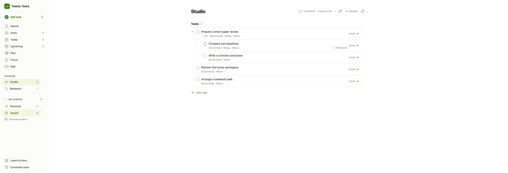

# Tasks row drag and selection, October 19

## Behavior

- Normal task rows have one completion circle, with a check on hover/focus. The extra left-hand batch
  checkbox is gone. Select task in the menu or Ctrl/Cmd/Shift-click enters selection; checkboxes replace
  circles in the same position. Clear returns to normal.
- Drag the title or row surface. The top/bottom insertion lines mean before/after at that row's level;
  the middle highlight means move under that task. Dropping beside a parent promotes its child to the
  same level. The target parent opens after a successful move; returning to a view still starts folded.
- A floating row preview follows the pointer and animates on drop. The existing handle stays available
  for keyboard dragging. Completion, expansion, menus and text inputs keep their ordinary behavior.
- Sidebar project/Inbox moves, additive labels and Today scheduling keep their existing meaning.
  Task IDs, dates, Deadline, kind and descendant identities remain intact. Steps remain absent from normal
  lists, and the parent editor reorders Subtasks and Steps separately using the same drag mechanism.
- Nested rows no longer repeat the already-visible parent title. The shorter rows keep one completion
  control aligned with the title.

The change reuses installed dnd-kit 0.3.2 and the existing Tasks update API. Tasks declares the same pinned
dependencies directly, with Vite deduplication across the linked planning package. There is no new backend
method, database migration, scheduler or persistent cache. Moving the pointer makes no API request; a drop
updates only the relationship/location/order fields and refreshes the existing bounded view. An unexpanded
new parent needs one one-row query to insert the moved task first.

## Verification

Tasks web lint/type/build, all 59 unit checks and the complete 65-case Chromium/local-D1 run passed.
The focused 28-case run passed too. New cases verify whole-row reparenting and promotion,
retained dates/kinds/descendants after reload, selection without a second completion control or horizontal
title movement, ordinary detail/completion clicks, visible drag feedback, cycle rejection, and pointer/
keyboard Escape cancellation without a write. Existing category, child order, pagination, context-menu,
save-in-place and completion checks remain. The complete suite also retains cached-dialog geometry,
planning/Focus completion, Mail, recurrence and narrow-window checks.

The test gesture follows a row's updated bounds after native auto-scroll. A previous single-point gesture
left the pointer at its old screen position after the dialog scrolled; the screenshot and bounding boxes
identified that cause. No product retry or timing delay was added. Ctrl-click tests use ControlOrMeta so
macOS's context-menu gesture is not mistaken for the application's batch-selection action.

Actual owner Chrome, against the disposable loopback/D1 instance, successfully dragged a title surface
under another task, promoted it beside its new parent, and moved it to a sidebar project. The moved child
appeared in its newly expanded parent and in the destination project. These fixtures contain no real
tasks or production credentials. Production task edits are excluded from acceptance.

## Release

Pending the complete branch gate and same-SHA main release. The previous production version remains
`455e4e8` while this follow-up is being checked. Only Tasks is intended to release.
