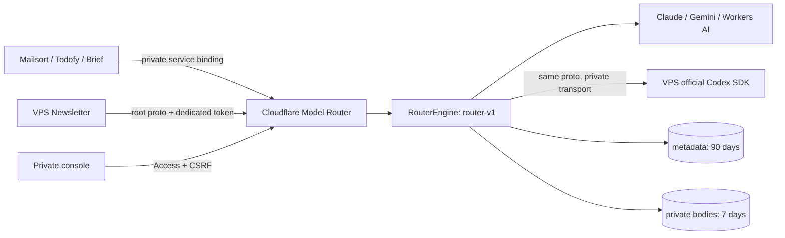

# 统一调用

`Generate` accepts a public `models/{id}`, trusted instruction blocks, untrusted input, optional standard JSON Schema and generic parameters. Unsupported controls fail before a model call. `ListModels` reports configured capabilities; it does not prove a subscription's current entitlement.

`request_id` identifies one invocation. Router registers it before execution and saves the final receipt. A repeated identical call returns the retained result; conflicting input is refused. It does not retry an interrupted execution on behalf of its caller. Applications retain their existing persistent retry decisions.

Provider differences stay in Router: Claude's stable-block cache and server fallback, Gemini's model chains and usage, and Workers AI vector order. VPS transport uses the existing `/api/codex/v1/model/*` Tunnel path with the same model proto bodies. Private ready/heartbeat/result SSE keeps that connection alive; applications receive final JSON.

## Short conversations

A caller may create a bounded context, send sequential turns and close it. Lifetime is fixed and at most 14 minutes; a new turn does not extend it. Codex uses one actual SDK thread. Other generation adapters receive the preceding validated messages. Newsletter still performs its own source validation and may send one correction within that same context.

Newsletter persists the context ID before creation. Closing an unknown ID leaves a closed receipt so a delayed create cannot reopen it. Closed, expired and lost contexts do not resume after a process restart. Close acknowledges execution cleanup; an unavailable close remains uncertain in the application's drain state.

## Records and budgets

Request lists and Home contain metadata only. Private request details load the R2 body separately. R2 expiration also cleans an orphan created before a failed D1 insert. Metadata is removed in bounded daily batches after 90 days.

Counts use one normalized per-call snapshot, including separate cached input and reasoning output. Conversation totals are converted to deltas in the Codex adapter. Missing usage remains distinct from zero. API cost estimates use Router's rate cards; subscription and platform-quota usage have no invented API price.

Brief and Mailsort keep their own budget ledgers and historical columns. Generic catalog reservation rates allow Brief to reserve before a call; actual normalized usage settles that reservation. Transport interruption preserves the application's conservative reservation. Todofy's existing daily token budget stays in effect for all selected models. Its model timeout is 180 seconds and summary watchdog is 7 minutes to accommodate the VPS round trip.

## Connections and release

Connections are scoped by authenticated application. `ANTHROPIC_API_KEY_MAILSORT` uses the existing Mailsort workspace; Brief uses its separate key. The owner Playground's explicit billing profile selects that same connection and its provider-side workspace cap; it does not spend through the app's local business ledger.

Publish using the existing green-SHA Actions flow and inspect the matching Personal cloud reconcile. The first deployment's DO namespace must be exported into the resource registry before acceptance. No app's paused/archive mode or historical result is changed as part of connection setup.
