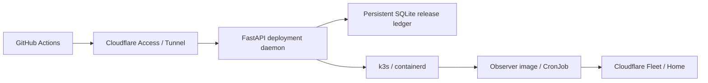

# VPS runtime · VPS 运行层

GitHub Actions calls the daemon's typed HTTPS release API through Access and an independent bearer. The official Kubernetes SDK applies only the configured namespace resources; the durable SQLite ledger and physical observations own release progress.

Build and check from the repository root:

```sh
bazel build //platform --platforms=//tools/bazel/images:linux_amd64 --embed_label=<full-source-sha>
bazel test //platform:check
```

`//platform:bootstrap_bundle` prepares the separate public installer input. Normal publication and deployment stay in Actions. Linux checks require Docker for the offline image probe and a separate privileged, API-only k3s fixture on loopback port 6443. The native k3s test runs the original SSA assertions and removes its unique container and volume. The image job compiles the reviewed AppArmor policy using the Ubuntu host parser.



A paired runtime release closes Newsletter admission and suspends its trigger. Its durable drain must be frozen and
free of active work before replacing the engine. Historical unknown outcomes remain unchanged and
visible as degraded business health; they do not authorize a retry. The daemon upgrades itself first, then uses the new
version's baked Kustomize resources. Checkpoints survive restart. Only physical Pod image IDs, observed
Kubernetes generations and process-baked source SHA/request ID prove the running version. After those
checks it resumes Newsletter and reports ready. A held release requires an explicit same-ID, current-etag
resume; retrying CreateRelease alone never reopens admission or forces ambiguous deliveries.

| Directory | Responsibility |
| --- | --- |
| `src/personal_cloud/deployment/` | Typed API, durable release states, namespace operations |
| `src/personal_cloud/status_daemon/` | Bounded actual runtime observations and adapters |
| `src/personal_cloud/observer/` | Read-only observations and signed receipts from the observer image |
| `k3s/` | Standard Kustomize runtime, volumes and least-privilege bootstrap resources |
| `systemd/` | Host boundary contract; unit templates are in `tools/vps-bootstrap/prepare.py` |
| `versions.json` | Pinned k3s and manifest compiler versions/checksums |
| `../tools/vps-release/` | Actions HTTP client; no host commands or runtime source imports |
| `../tools/vps-bootstrap/` | One-time privileged installer and public bundle preparation |

Newsletter, the daemon and Codex gateway have separate images. They carry the release's source SHA and are promoted
from the exact tested image tar; deployment uses registry digests. The daemon Deployment and observer
CronJob use the same platform image. No application executable or Python dependencies are installed on
the host. If k3s stops, Fleet marks observations stale or missing rather than guessing unit states.

The Codex gateway has its own one-target release path. It does not change Newsletter admission or
its daily trigger, and it is the only Pod that mounts the existing Codex login volume.
The existing platform Tunnel routes its exact inference prefix through a separate path-scoped
Access application. Gateway process health is separate from login, quota and actual inference results.

The owner separately authorizes the prepared one-time bootstrap. Initial engine admission stays frozen until the
first verified API release. See [rebuild](../docs/rebuild.md) for configuration, secrets and recovery limits.
Synthetic tests do not prove Codex login, external providers or a live new server.
The legacy editorial config-sync process downloads validated content bundles; it does not reconcile
infrastructure or choose executable releases. System installation and disaster recovery remain privileged.

The owner-authorized native Actions connection manages cluster-scoped Kubernetes resources and new application
resources. Its short-lived CI identity is separate from the namespace-scoped runtime daemon and business Pods.
Existing Newsletter and gateway releases retain their drain and physical verification contracts. The private
runbook owns the initial trust handoff and connection checks.
