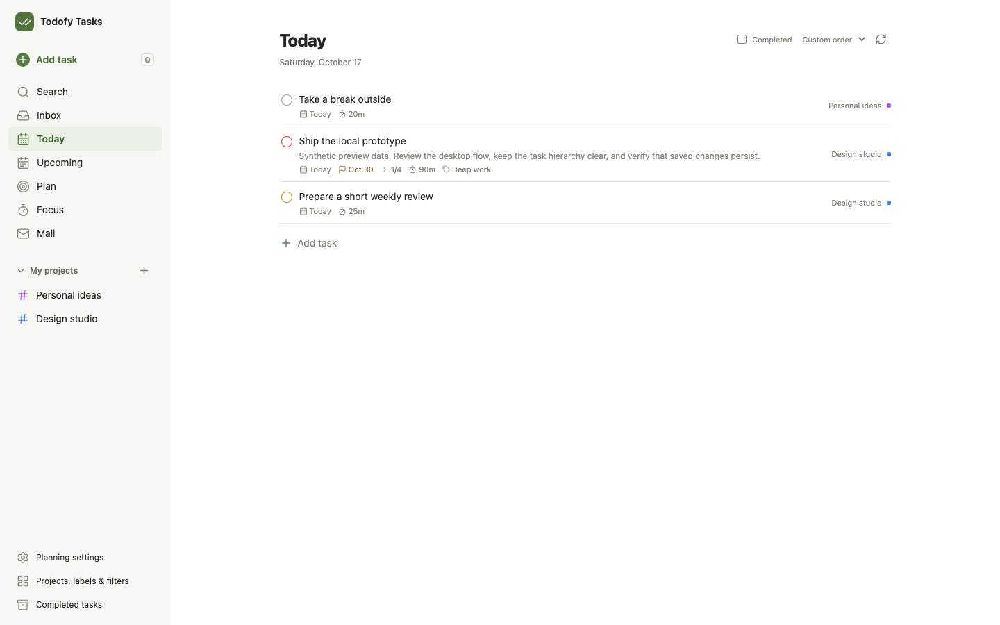
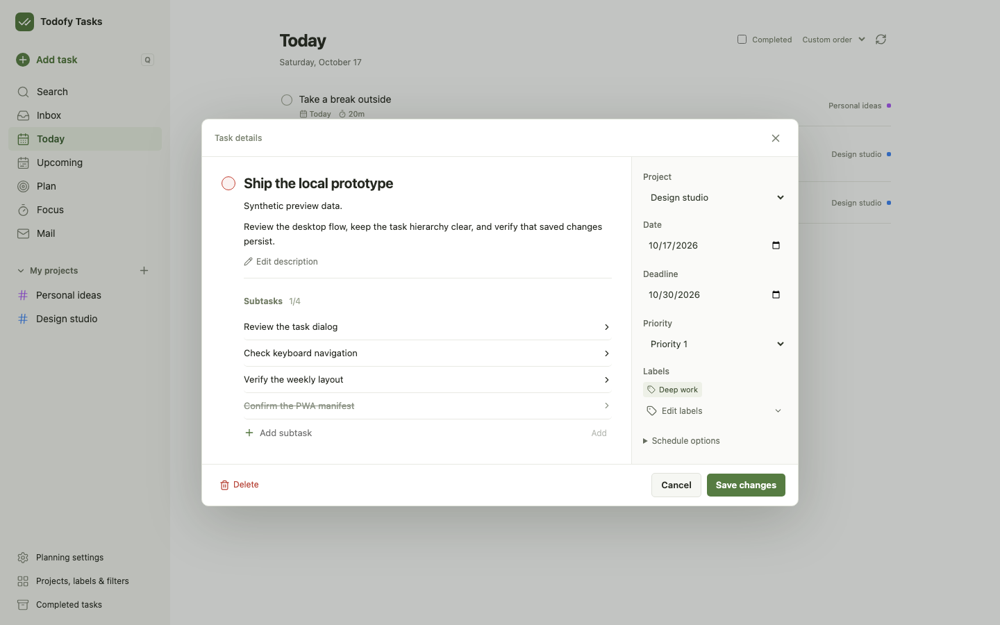
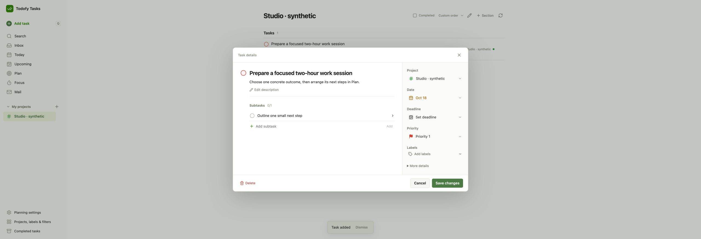
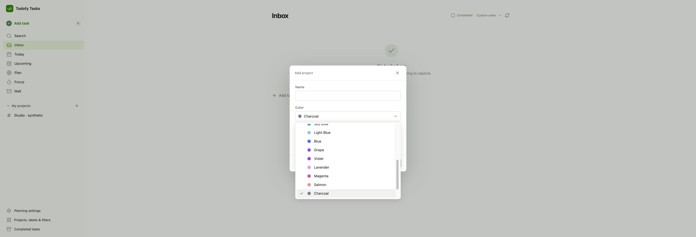
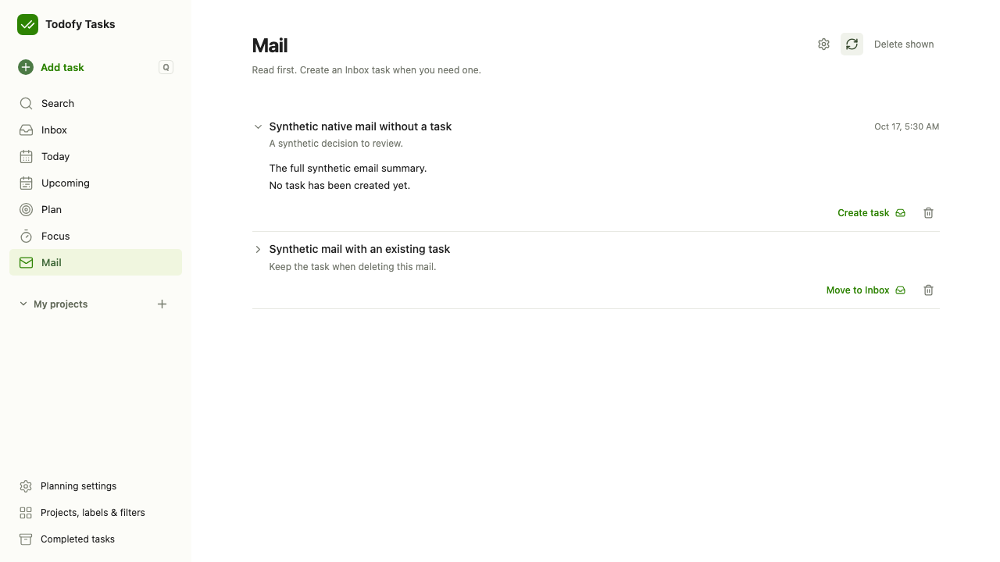
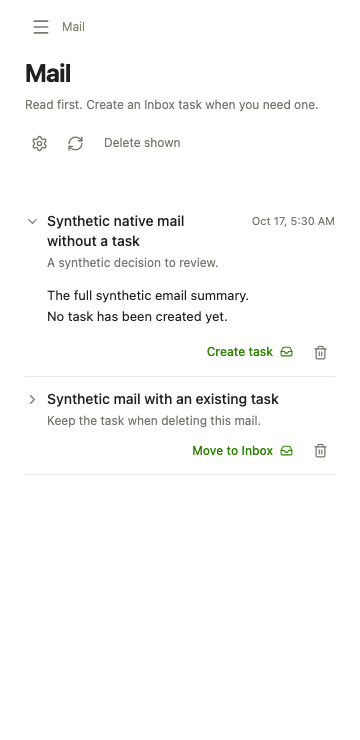
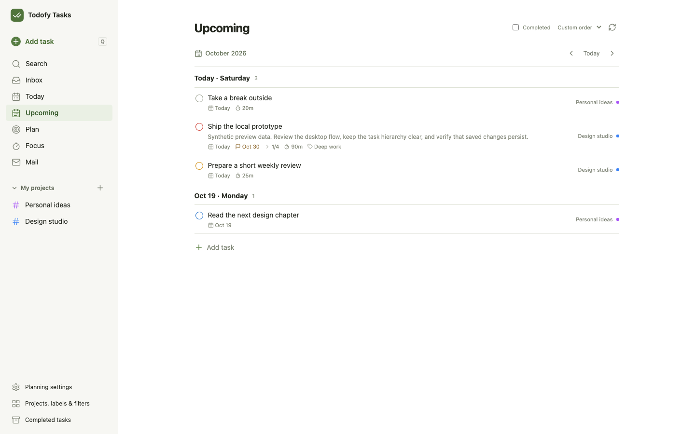

# Tasks architecture and interface

Tasks is the owner's desktop task application and installable PWA. It keeps the familiar Todoist layout:
sidebar navigation, compact task lists and a centered task editor. Plan and Focus reuse the shared planning
components; Mail has its own taskless inbox. Comments, files, reminders, collaboration, external calendars and voice are
outside the approved scope.

## Service boundaries

| Component | Owns | Interface |
| --- | --- | --- |
| Tasks web | Navigation, draft forms, selection and rendered views | Generated `TasksUiService` client, same-origin owner requests |
| Tasks Worker and D1 | Task/Subtask and Step content, effort, catalog, dates, completion history, planning facts, dependencies, Plan's weekly goals and lane orders, and Focus's day queues, timer and time records | Root `proto/tasks/ui/v1`, named `TasksApi`, read-only `Ops` |
| Todofy | Mail, the weekly review task and operation receipts | Named `Planning` binding, limited to the Mail methods and ReadWeeklyReview |
| Shared planning UI | Plan, Focus and the optional Mail shortcut editor | Caller-supplied typed transport and navigation callbacks |

Applications do not import each other's source or databases. `packages/planning-ui` compiles into
Tasks; `packages/task-dates` supplies the date parser used by the Tasks Worker and import tools. A `read`
binding may only read Tasks; Todofy receives the provisioned task API; other bindings are rejected.

Tasks is the only task source; no consumer reads or writes Todoist. Existing task IDs and planning internal
IDs survived the cutover.

## Task interface

Task and Subtask share `kind=task`; their hierarchy describes outcomes. An executable Step is a generic Task
resource with `kind=step` and a Task/Subtask parent. A Step cannot contain children. Only Steps and Tasks
explicitly marked Standalone action enter the day calendar. Adding an ordinary Subtask does not make it a Step.
The editor separates Subtasks and Steps, with completion, reopening, deletion and Step estimates in each list.
It reads a task's children only when its GetTask reply counts some (`child_count`).
Quick implies Standalone: new writes enforce it, and existing Quick state is projected as standalone without
a database backfill. Clearing Quick retains Standalone until it is explicitly cleared.

Main lists also expose collapsed child branches. Expansion reads the existing parent query in bounded
pages; the same row actions work for children. Today/search children already present in the root result
are not duplicated. Ordinary lists/counts omit Steps; parent, explicit-ID and `all` reads retain them.
Completed visibility follows the current view. Child refreshes retain the rendered
rows until their replacement arrives; collapsed branches make no background reads.

Row metadata separates native `#...` properties from real labels with a divider and tag icons. Planning
facts come with each row, so they never arrive after it. Opening a child branch reads only that branch, and
opening a task reads it once (GetTask), with its dependencies.

The parent editor also saves Subtask and Step ordering on drag/drop within each group. The drop line
supports insertion before or after another child and changes only `sort_order`. It uses custom child
order independently of the main view's sort selection; dragging cannot convert a Subtask into a Step.
Lists and child editors use the existing dnd-kit version. A six-pixel mouse movement starts a drag from
the title or row surface; other controls keep their ordinary clicks. A floating preview follows the pointer
and animates on drop. The handle remains for keyboard use. Main-list row edges insert before/after at
the target's parent level; the middle moves under that task and opens its child branch. Known descendant
targets are disabled; the existing Worker rejects cycles. Only drop saves a narrow etag-checked update,
never pointer movement. No new backend method, schema or persistent drag state is needed.

Nested rows use indentation for parent context without repeating the parent title at the right. A normal
row has one completion circle, with a tick on hover/focus. Select task in the menu, or Ctrl/Cmd/Shift-click,
enters batch selection: its checkbox replaces that circle in the same slot. Clear exits selection.

Main-list subtasks can also be detached as independent tasks. Sidebar drops move to an active project or
Inbox, add a chosen label, or schedule Today. They read a fresh task etag and use existing narrow updates;
project moves preserve descendants. Saved filters have no inferred drop semantics.

Title, description and visible planning options stay in the main editor. Project, Date, Deadline, Start ahead,
priority, labels and Effort occupy the narrow property rail. Start ahead accepts days or weeks before the
Deadline and feeds Plan Review's Start now lane; it does not schedule a notification. `effort` is empty, `deep`
or `shallow` in Tasks and does not change ordinary labels. Clock time and estimate controls appear only for
executable items. Untouched imported timed values remain stored.

Date's Repeat controls select frequency, interval, weekdays, month day, annual month/day and whether an interval
counts from completion. They serialize into the existing recurrence field; the Worker still advances dates.
An imported rule the controls cannot represent stays unchanged until the owner chooses a replacement.
Completed children remain visible. Moving an existing timed date retains its clock time in the task's
timezone, including daylight-saving changes. Context-menu date text saves ordinary Tasks as calendar dates
and points to task details for explicit executable timing; Steps retain the entered time.

Existing descriptions render Markdown and bare links; Edit description opens the draft and Done returns to
the preview. Save changes persists the draft. The editor, Plan and Focus load with the app, so their first
open waits for no chunk and no Suspense reveal. The renderer loads in its own chunk, as Mail and the catalog
editor do; it omits remote images and raw HTML, and opens links only on a user click. A failed completion
shows its reason inside the open editor.
Existing saves keep the editor open with the returned write baseline and unchanged frame/scroll; an
unchanged save writes nothing. Creation, completion and deletion retain their existing close behavior.

Quick Add opens with `Q`; `Ctrl/Cmd+Enter` saves, Escape and backdrop close the dialog. Create actions retain
their request identity after a lost response. Lists support selection, batch completion/move and custom
order. A normal new task appends to its sibling list inside the D1 transaction; explicit positions remain
available for planning writes. Cross-project moves preserve descendants and update parents before children.

Native planning stages, areas, lead windows and status flags are task columns (migration `0006_planning.sql`),
written by the same UpdateTask as the task's content under one etag; ordinary labels remain content
classifications. The rules are the Worker's (`worker/src/planning.ts`): a commitment is for a week
(`committed_week`, the next one when chosen on a Sunday) and reads as `weekly` once that week has ended, with
no write; newly parking a task clears its stage and `active`; Quick implies Standalone action; no deadline means
no start-ahead days. Each Task answers its rolled `stage`, Review's lane (`board_stage`), `must_start` and
`missing_lead` for Tasks' today.
The facts, dependencies, goals and lane orders Todofy kept before this were copied in once on 2026-10-20
([backup](backup.md#one-time-planning-import)).

Dependencies (`task_dependencies`) name prerequisite task IDs and derive Blocked from their completion state;
there is no independent Blocked checkbox. They are written as the task's whole set with
`update_mask=dependencies`: at most 5 per task and 300 in the account, no cycle, an open prerequisite, all
checked inside the write's batch. A removed edge is soft-deleted and revives when added again. Deleting a task
removes the edges at both ends; completing one removes the edges of what it waited for. A prerequisite is done
once completed, in an archived project (until the project is back) or, when it repeats, completed again since the
edge was added. A set that keeps an edge keeps it as it is, done or not, so Plan waits for a recurring
prerequisite's next completion by removing it and adding it again.

Plan's weekly goals (`weekly_bets`, one line per week and area, this and next week writable) and the owner's
order of each Review lane (`plan_board`, one document) are read by GetPlan with next week's commitments, in
one batch. A goal is a value write with no request ID: the saved text answers as saved; otherwise its etag must
match. A lane order is saved by ReorderTasks with `lane_order`, beside the moved siblings' positions.
Dragging a task into a planning day changes Tasks' day queue with one `MoveFocusStep`, preserving its task
date and real deadline. A day holds at most 20 steps. Deleting a task, its project or its section takes its
steps off every day in the same batch, so they never fill a day; its time records stay.
A task write Plan did not issue (the task dialog, the list) makes a mounted Plan or Focus read again once. Plan
reads its own writes back itself, so completing a card costs one read, and switching between Plan and Focus
reads nothing (`request-counts.spec.ts`).
Plan keeps the candidate columns vertically stacked within their existing desktop row. Committed alone
spans the row below, with horizontal cards aligned to those columns; narrow layouts keep the existing
paired/single-column behavior. Review cards, the commitment overview, next Steps, Quick and scheduled
Steps reuse the existing completion operation. A calendar completion supplies its own day as `focus_day`;
the others supply Focus's day. The Tasks host reuses the generic list completion path: original etag and
request proof, and count/cache invalidation. Repeated queued commands retain their first task revision and
Focus day; a finish operation cannot become a Reopen after a fresh read.

## Focus completion

Focus keeps one timer in Tasks (`focusTimer`): Start counts on Tasks' today, Pause and Resume keep the
session, and Stop or a pomodoro's Finish saves it as one record of whole minutes when it reached a minute.
Count-up, Focus's default, stops at four hours. Completing a task, from any list, Plan or Focus, is one Tasks
`CompleteTask` batch: the occurrence, the task and its Steps marked done in `focus_day`'s queue (empty: Tasks'
today), and a related running or paused session on the task or a descendant saved as a record and stopped, its
Steps marked on the session's own day. An unrelated timer is left alone, and completing an unplanned task adds
it to no queue. Reopening opens the queue rows that completion marked. There is no separate settlement step to
fail. Records are edited, added and deleted one at a time with their etags; Focus's Week and Month read their
days with `ListFocusDays` (at most seven days a call) and total them in the browser, so the Worker does no
aggregation.

Pause and Resume may take effect earlier than now: `CommandFocusTimer.effective_time` (PAUSE and RESUME only,
anything else is `INVALID_ARGUMENT`) is moved into its range, a PAUSE's between its running segment's start and now
and a RESUME's between the moment the session paused and now. `FocusTimer.pause_time` (`focus_timer.paused_at`,
migration `0007_timer_pause.sql`) says when a paused session paused. So away detection pauses at the moment the owner
left; keeping that time resumes at `pause_time`, as if the session never paused; discarding it resumes now; and Stop
while paused leaves it out of the record. A pause made before that migration has no `pause_time` and resumes now.
The time is part of the request's receipt, so a replay with another time is refused. The server stores what it is
sent to the second, as every pause does.

## Native Mail and planning calls

Mail is Todofy's inbox, displayed in Tasks without first creating task records. A successful native summary
finishes its existing event and saves a summary with an empty task link. The owner chooses Create task;
Todofy then sends a generic Tasks CreateTask into the default Inbox and records the confirmed link. Existing
linked mail tasks keep their IDs. Deleting a Mail summary does not delete a linked task. The full stored
summary is available through `/?mail=<eventId>#/mail`, including after filing; a long Task description links
back to it rather than discarding the tail.

The Mail page reads only its bounded mail API and summaries expanded by the owner. It does not load Plan,
Focus or a task-project snapshot to discover mail. Optional tag/priority shortcuts are ordinary Tasks
labels, separate from planning flags. Weekly review and GTD carryover count the pending Mail collection.

Planning and order writes are Tasks' own; Todofy's filing writes use generated Tasks method/body requests.
No Todoist path or fallback remains. A binding grants `read` or `read-write` access,
so the Tasks implementation does not enumerate application names or understand mail categories.

Bulk order updates use one Tasks request, one receipt and a bounded D1 transaction for all supplied etags.
They avoid one service call per task. Cloudflare documents a finite invocation chain for
[service bindings](https://developers.cloudflare.com/workers/runtime-apis/bindings/service-bindings/#limits).

## Installed app

The manifest (`web/public/manifest.webmanifest`) keeps `display: standalone` and adds three members:

- `shortcuts`, on the Dock icon's menu in this order: Quick add (`/?add=1`), Today, Plan and Focus. macOS shows no
  shortcut icons. Quick add opens the Add task dialog with no project and no date: the Dock has no page context, so
  it captures to Inbox over whatever page the window shows (a new window shows Today); the in-app `Q` keeps its
  contextual defaults. The parameter is removed at once, so a reload does not reopen the dialog. An installed app
  takes a manifest change at Chrome's next update check, at most daily, without reinstalling.
- `launch_handler.client_mode: ["focus-existing", "auto"]`. Chrome (139+) opens an in-scope link from a browser tab
  in the installed app; with `focus-existing` an open app window is focused, not navigated, and the URL is queued
  in `window.launchQueue`. `navigate-existing` would reload the page, dropping open dialogs, Plan's in-memory state
  and anything tied to the page. `web/src/launch.ts` reads the URL (`readLaunch`) and `App` routes it in place: the
  hash route at once; `?review=1` (with no route: Plan) opens the weekly review checklist, as a counter so a second
  link reopens it; `?mail=<event>` opens Mail's summary, since a long mail task's description links there; a
  `?task=<id>` or Quick add opens once no task dialog is open, so a launch never discards a draft (only the newest
  waits; the task already open is left alone). A task launch puts `?task=` into the URL, so the load path's rules
  hold: a reload reopens it, closing removes it. Chrome also queues the launch that created a window, whose URL the
  load path has handled, so a first launch equal to the document's URL is skipped. Home's `/` only focuses the
  window. In a plain tab the consumer is never called and links load as pages, as before.
- `display_override: ["window-controls-overlay", "standalone"]`. When the owner hides Chrome's title bar, a strip
  in its place drags the window (`app-region: drag`) and continues the sidebar's and the page's colours to the
  window's top edge (white below 760px). Inside the titlebar area, clear of the traffic lights and Chrome's own
  controls, sit one search field and the page's refresh button. Typing in the field on another page goes to
  Search; `/` and Cmd/Ctrl-K open Search with the caret in it; Search shows no field of its own, and leaving it
  clears the field. The refresh button keeps its component; CSS moves it there (`.view-refresh`, `.plus-refresh`).
  The theme colour turns white meanwhile. `web/src/titlebar.tsx` follows the display mode's media query, whose
  `change` event fires both ways, and puts `titlebar-overlay` on `<html>`; every overlay rule hangs off that class,
  so the normal layout is unchanged.

### Focus mini timer

The timer bar's last button, Mini timer (`aria-pressed` while open), opens the session in a Document
Picture-in-Picture window (Chrome 116+; no button without the API): a window that floats above other apps, cannot
be navigated and closes with the page. planning-ui renders `MiniTimer` into it through a React portal, so its
Pause/Resume, Stop and Complete call the timer bar's own functions through App's one write queue, disabled while a
write waits; there is no second timer state and nothing is stored in the browser. The window asks for 320 × 120
(Chrome then reuses the size and place the owner leaves it at) and holds its layout from 240 × 72 up. It gets one
`<style>` (`mini-timer.css`, imported as text) and the opener's computed `--plus-*` tokens and font, so Tasks'
overrides carry over without copying the app's stylesheets. It ticks on its own window's timers, to the session's
next whole second: the opener's run late while it is hidden or minimised, which is when the mini timer is looked
at. The 60-second timer read also runs while only the mini timer is visible, and when its window gets focus.

It closes when the session ends (Stop, Finish, a confirmed completion, or a read with no timer), when the owner
closes it, and when Plan/Focus unmounts. To keep it on other pages, `App` keeps PlanningPage mounted while a
session exists (`onSession`), with `background` set: it renders only the mini timer and keeps its data, write
queue, timer read and pomodoro Finish. Full reads (after a task write elsewhere, or on returning to the window) wait
until Plan or Focus shows again; then one runs if any was missed, with writes held until it lands, or if the data is
over a minute old. The cost is one `GetFocusTimer` a minute while a session exists and a window is visible; with no
session nothing stays mounted. A failure in the background shows nothing on the other page and resets when Plan or
Focus opens.

Headless Chromium cannot install an app: `pwa.spec.ts` checks the parsed manifest, `pwa-launch.spec.ts` stubs
`launchQueue` and calls its consumer as Chrome would, and `titlebar.spec.ts` stubs the display mode (its
`env(titlebar-area-*)` fallbacks apply). `mini-timer.spec.ts` uses the real Document Picture-in-Picture API (only
the window's size is set by the test: headless Chrome opens it at the page's viewport). The Dock menu, links from
Gmail and Todofy's `/task/<id>` redirect landing in the open window, the title bar's toggle and clearances, and the
mini timer's first size, resizing and remembered place are checked by hand in the installed app.

## Performance and Cloudflare

Task pages are limited to 100 rows. Lists return a short description preview; full descriptions load when
a task opens. Indexed keyset pagination serves tasks, changes and history: a task cursor compares a row value
and a task-ID lookup joins `json_each`, so both seek an index. Consumers advance their own change cursor.
Timer rendering needs no server polling.
Plan is one GetPlan batch beside the pages of open tasks; each task row brings its planning facts and its
dependencies (one correlated subquery), so nothing reads planning separately. `cpu.test.ts` bounds a page of
100 planned tasks (60 waiting for 5 each), the fullest plan and a dependency write; `read-budget.test.ts` bounds
the rows GetPlan and a task's dependencies read.

An isolate's start costs more than any request. The global scope's warm-up (`src/startup.ts`) measured 19.4-20.8
reference ms on its first run (three runs, 2026-10-20): about 11 for the first Intl initialization and 9 for
warming the task page's and the Focus week's code. Every request `cpu.test.ts` measures stays below 10 even as an
isolate's first request and below 8 warm: owner pages, GetPlan, reorders, duplicates, the backup's pages and plan,
Home's `Ops.status()` and Todofy's service calls (a footer search of 20 full descriptions, a page of 100); 5.8 was
the highest first run and 4.2 the highest warm median. Completing a family is a fixed number of D1 statements, its
subtree walked in D1, not in the Worker. So the only measured work near the CPU p99 Home's Cloudflare view showed on
2026-10-20 (20.5 ms, p50 2.9 ms) is an isolate's start: the p99 matches new isolates (after a deploy, or an evicted
one), not a heavy request. That reading assumes the metric counts an isolate's start with its first invocation,
which Cloudflare does not document either way. Cloudflare limits startup separately (1 s), and its metrics page
notes that high quantiles can pass the CPU limit without errors.
`cpu.test.ts` bounds the warm-up's first run at 30 reference ms.

Migration 0004 keeps reads independent of history. An open-roots index serves the Inbox and project roots
without completed tasks, and a partial index counts only native completions, not imported occurrences.
Section and project visibility triggers run only when `archived` (or a project's parent) changes, so a
rename or recolour touches no task and leaves list etags valid. A label rename writes its catalog change
before its task changes, so a paged change reader refreshes the catalog first. `read-budget.test.ts` holds
these row counts.

Todofy's weekly backup reads every table through the machine-only `TasksApi.exportBackup` (read-write
bindings only, no HTTP route): rowid pages below each table's max rowid at plan time, bounded to half a MiB of
row JSON so a page stays within Workers Free's CPU. [backup.md](backup.md) has the restore.

D1 batches atomically store each write with its request receipt; updates carry masks and current etags.
Resource references are checked again by database triggers. A task family is limited to 32 hierarchy levels;
moves batch by depth to stay below Workers Free's D1 query limit. No new queue, DO or cron is needed.

Owner requests validate Access before reading the body and validate Origin/CSRF before mutation decoding.
The CSRF token and cookie last 168 hours, the Access session's length, so a PWA left open overnight can still
save its first edit without a refresh. The web reads the token at startup beside the catalog, so the first write
does not wait for it; a write still reads it when that failed, and a 401 or 403 drops it.
API responses, HTML, manifest and service worker use private no-store headers. Hashed JS/CSS can use the
browser's private immutable cache. The service worker only supplies a clear offline page; it does not cache
private tasks, credentials or writes. The installed PWA needs a connection to use task data.

A tab opened before a release keeps its old bundle. Every authenticated answer names the Worker's build
(`BUILD_SHA`) in `x-tasks-build`, and the release builds the web from the same commit. When an answer comes from
another build, the tab shows "Tasks was updated." with Reload in place of the page and its errors. Where either
build is unnamed (development, a manual build), an unknown route (404 "Unknown API route", or 405) does the same
(`web/src/outdated.ts`, `shared/build.ts`).

## Synthetic interface references

These images contain only local synthetic data. The shared planning interface is documented in
[the planning UI interface guide](../../packages/planning-ui/docs/interface.md).

Import commands and the remaining real-data boundaries are in [import.md](import.md). Actual verification,
including what has not been deployed or migrated, is in [verification.md](verification.md).
