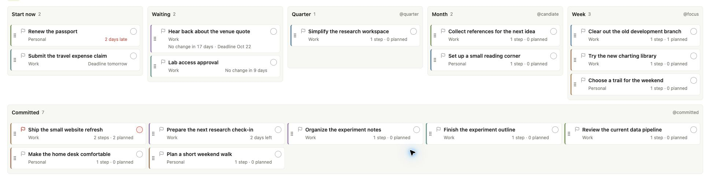
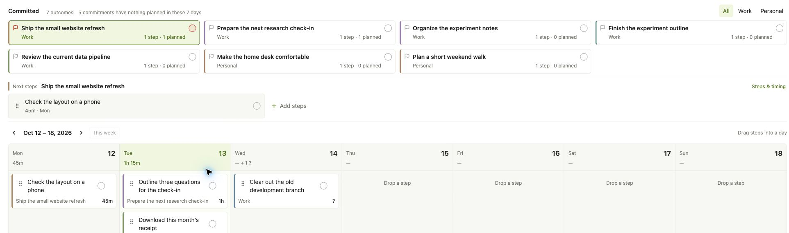
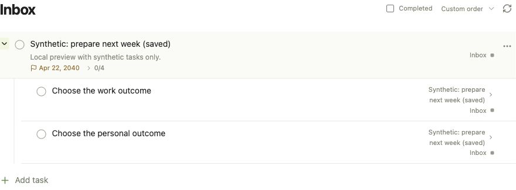
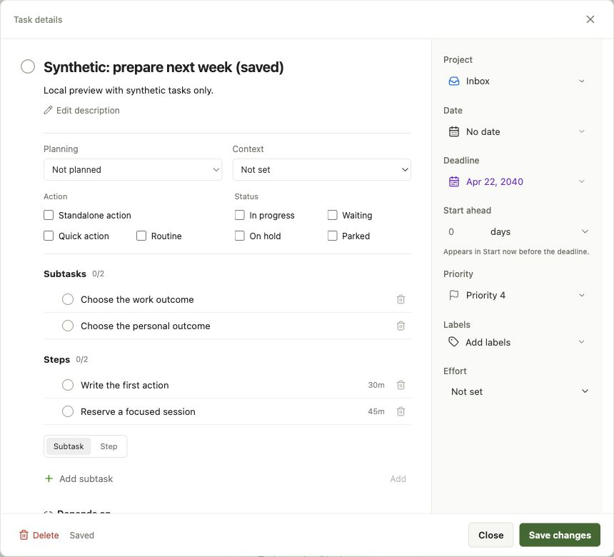
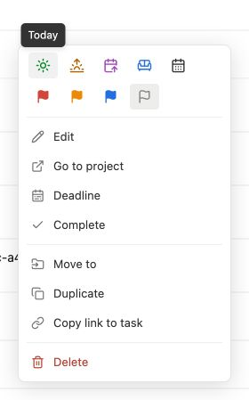

# Inline subtasks and operations follow-up

This record covers the initial `455e4e8` rollout. The later whole-row drag and selection update is tracked
in [its acceptance record](../../docs/tasks-row-drag-verification.md); the old native-drag limitation below
describes that initial version.

## Behavior

Main task lists show a chevron for parents. Children start collapsed and are read only when expanded,
using the existing parent query with 100 rows per page and an explicit Load more control. Subtasks can
expand recursively. Ordinary views/counts omit Steps; details and execution views retain them. Existing edit, completion, selection, context
menus and sibling ordering remain available. Children already listed independently in Today/search
stay in place and are not duplicated under their parent. Completed visibility follows the list setting.

The browser preserves rendered children during a refresh and ignores replies for a closed or replaced
branch. Opening a different view or reloading starts collapsed again. The schema and wire format are
unchanged. There is no new persistent cache, polling or dependency. Parent progress retains all-child counts.

The parent editor's Subtasks and Steps each support dragging within their own group. A visible line
shows whether the item will move before or after its target; one existing task update saves the order
on drop. Task kind, parent and all other fields stay intact. Main lists and the editor share the same
small numeric-order calculation; the editor does not depend on the main view's current sort selection.

Existing editors stay open after Save, keeping their frame and scroll position. The footer confirms
Saved; further edits use the returned revision, and unchanged saves write nothing. Creation, completion
and deletion keep their existing closing behavior. Main-list dragging can detach a subtask onto a root
row or the independent-task area. Its ID, project, dates, planning facts and descendants are preserved.
Normal date labels add the year outside the account's current year; month/week headers already include it.

Ordinary API views select outcome tasks. Explicit-ID reads, parent reads and `view=all` retain Steps;
the dependency picker uses `all` with bounded search text. No IDL or database migration is needed.

Row metadata now shows native stage, action/status options, effort, context, Deadline and start-ahead
as compact `#...` properties. Actual labels have tag icons and a divider. Planning reads are batched by
100 IDs, with a reserved line that keeps the row and real labels still as the reply arrives. Row reads
do not seed the full-detail cache. Core outages leave task content visible with a specific status.

Dragging to sidebar project/Inbox uses the existing family move, clears the old parent/section and
preserves descendants. Label drops add membership; Today moves the calendar date while preserving the
real Deadline. All start with a fresh task etag. Saved filters have no guessed drop operation.

Plan's other desktop lanes remain in one row of vertical columns. Committed alone spans the row below,
with horizontal cards aligned to the candidate columns; the existing narrow paired/single-column
layouts remain. Alignment also keeps the existing keyboard spatial navigation on adjacent cards.
Outcomes, the commitment overview, next Steps, Quick and scheduled cards now expose completion through
the existing command queue and request receipts. Calendar completion passes its actual FlowDay date.
The native host uses the same generic completion/Focus proof as task lists. Completing an outcome also
settles its running completed descendant on the timer's original date; it does not reopen an already
completed task. A repeated queued request retains its original task etag, including recurrence.

Quick is always standalone. Core projects existing Quick rows as executable without a read-side write
or backfill, enforces the same rule on new edits, and keeps content labels separate. Both editors show
Standalone checked and unavailable while Quick is selected. Clearing Quick retains Standalone until
the owner explicitly clears it. Recurrence, deadlines, task kind and real labels are unchanged.

Project Edit also waits for catalog metadata: an early click previously opened the Add project form
because the selected project was still undefined. A browser regression reproduces that exact race.

## Local checks

On 2026-10-18 (America/Los_Angeles), Tasks web lint, typecheck, build and all 59 unit checks passed. All 62 Chromium journeys
against real local D1 passed, including folded first load, nested outcomes, hidden Steps, editing, sibling
dragging, completion/reopening, adding the first child, Today de-duplication, bounded pagination and
selected-child actions, save geometry and persisted outdent. Existing cached-dialog and popup layout
regressions also passed. Sidebar family moves, additive labels, Today with a preserved Deadline, batched
property reads with stable row geometry and Quick's immediate scheduling controls are covered too.
Worker lint/type, 2 units and 41 runtime checks passed. Read-budget measurements
remain 179 rows for a full Catalog, 10 for metadata only and 298 across count-history growth, all zero writes.

The added detail-drag regression performs an upward Subtask move and a downward Step move while the
main list uses Name order. It reloads/reopens the editor and verifies persisted ordering, unchanged
parent/kind/estimate/completion fields through real D1 reads. Existing main-list dragging and warm/narrow
dialog checks passed too. Shared planning typecheck and 23 units pass; its legacy consumer retains 308
passing units. Core's focused 34 checks include real Python/TasksApi/D1 execution: existing Quick rows
gain the effective standalone flag while the physical row and revision remain unchanged, new writes
enforce it, and exact request replays still work. The complete branch gate and final live checks have
passed. A CI-only teardown race in the synthetic planning routes now waits for in-flight handlers, and the deletion test waits for the loaded zero counts;
no assertions or callback errors are ignored.

Real owner Chrome also verified collapsed first load and nested expansion in the ephemeral preview.
Only synthetic tasks appear in these screenshots. Chrome Save leaves the editor frame unchanged and
shows the full future year. The final production rollout and read-only owner-page checks have passed.

The same Chrome also rendered the actual bundled planning components with synthetic data: candidate
columns remain together, Committed is below them, and completing an outcome changes its count from
eight to seven. Completing an arranged Step removes it from the tray/calendar and reduces the day estimate.
These are synthetic UI checks, not writes to the owner's production tasks.

Owner Chrome confirmed the editor layout and draggable handles. The computer-use drag driver did not
produce a drop, including in the unchanged main-list control, so that gesture is excluded as a success
claim. Actual drag/drop and persisted order are covered by the Chromium/local-D1 regression above.

The right-click and More menus use the installed Base UI tooltip for each schedule/priority icon,
with the same visible names as their existing accessible labels. The browser check hovers all nine
icons, verifies the displayed explanation and unchanged menu bounds, then performs real date/priority
writes against local D1. No scheduling semantics changed.

## Release

Implementation `455e4e8888991ac05ca44f459b7515e3fe831d21` passed the complete branch
[39181190423](https://github.com/ziyixi/todofy/actions/runs/39181190423), including all three Core
runtime shards, Tasks, shared packages, contracts and the packaged legacy UI consumer. Same-SHA main
[39181722770](https://github.com/ziyixi/todofy/actions/runs/39181722770) completed successfully.
Tasks ran 59 units and 62 real Chromium/local-D1 journeys; the shared package ran 23 units, and the
retired extension consumer ran 308 units and 65 packaged-browser journeys. Existing budget and safety
checks remain enabled. Only Tasks and Todofy deployed; the installed extension and VPS were not updated.

Independent read-only Cloudflare checks verify the source SHA, persistent resources, public vars,
bindings, schedules, exposure and routes with zero differences for each Worker:

| Worker | Actual version | Verified Deployment |
| --- | --- | --- |
| Tasks | `15ed9b3c-c787-4467-8b3c-ffdcf4b364ce` | `7163101870` |
| Todofy Core | `a98f12cd-5fc0-4d60-98fa-ef42f6397c58` | `7163118808` |
| Todofy gateway | `8b59bffd-d05a-41d5-b3e3-0524024e0e76` | `7163118808` |

Owner Chrome loaded the matching `index-C6d4HG8y.js`. Bounded DOM observations verify one row of
candidate columns, a full-width Committed region below them, horizontal card columns and visible
completion controls in Review/Week. After Core released, one existing Quick's checked Quick and checked,
disabled Schedule as a step controls were verified without saving. Its dialog was closed; the owner's
Week selection was restored. No production task was completed, moved or edited for these checks,
and task titles/descriptions were not emitted or captured in public screenshots.
A fresh owner Home refresh reports all eleven app tiles and both background services normal, with no
attention items; no alert was dismissed. The original and other agent's checkouts remain untouched.

The screenshots above use a bundled synthetic preview. An unbundled Vite preview encountered a plugin
registration error and was excluded from acceptance evidence; the packaged builds and browser suites passed.

## Owner-approved archive

The requested obsolete email entry was a project, not a saved filter. The owner explicitly approved
archiving it after reviewing the counts. The standard owner UI saved Archived, then a separate metadata
query confirmed all 2,307 task IDs remain: 192 incomplete and 2,115 complete, all hidden from active
project views. No tasks were deleted and no source Todoist objects were changed. Private project
identity and screenshots remain outside this public repository.

## Cloud recovery

Personal cloud reconcile [39147228294](https://github.com/ziyixi/todofy/actions/runs/39147228294) failed
only its VPS comparison with `RUNTIME_COMPARISON_UNAVAILABLE`; Worker comparisons passed. The host API
was reachable while Pod host-address metadata no longer matched the current host. The owner ran the
existing runbook's k3s restart. All three running Pod UIDs, readiness and restart counts were preserved.
Attempt 2 reran only the failed job and succeeded. Fleet subsequently reported a ready runtime,
healthy Newsletter, active monitored daemons and a clean reconcile plan without a new application rollout.

Mail Hero's separate stale-backup alert came from `native_backup_lease_expired`. A retry through its
existing native R2 snapshot runner created snapshot `65cc4689-64b4-4d0e-9019-dd5ed88813c9`, fully verified
at 2026-10-18 22:33:49.013 UTC: 1,903 files and 66,221,731 bytes, `native_readback_verified`.
The copy and validation finished in about 28 minutes and the existing pause was released. No backup
contents were downloaded or printed. After the next due owner refresh, Home reports every app normal
and no attention items. Its stale-backup warning recovered from the actual successful timestamp; no
alert was dismissed.
This incident does not establish a permanent fix for host address changes or future snapshot timeouts.
