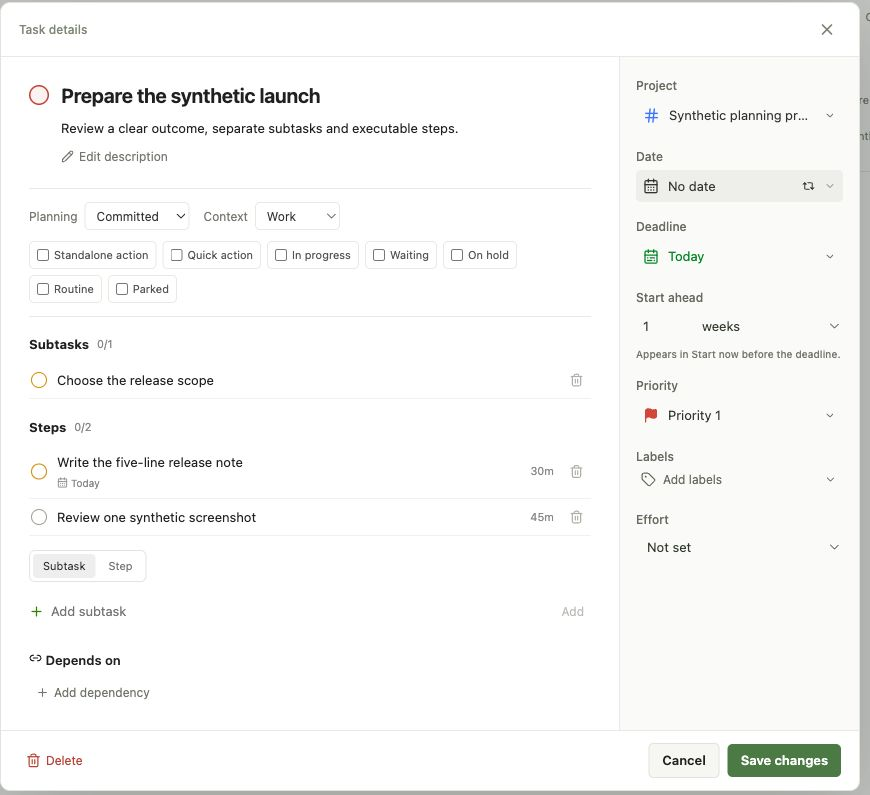
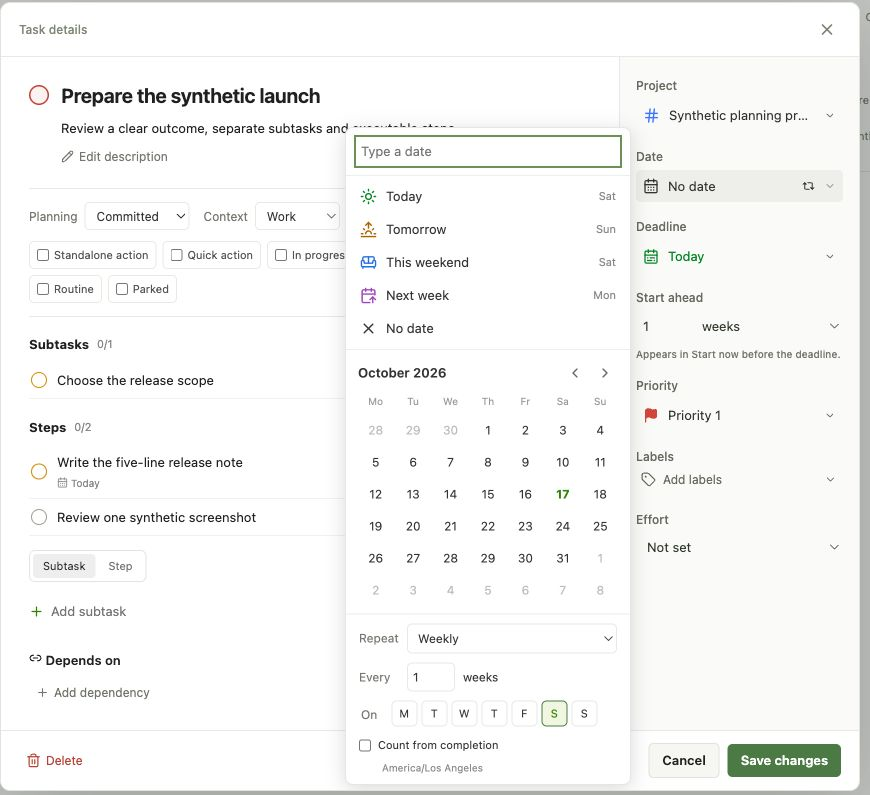
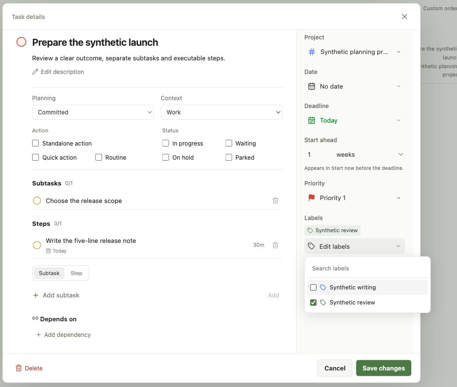
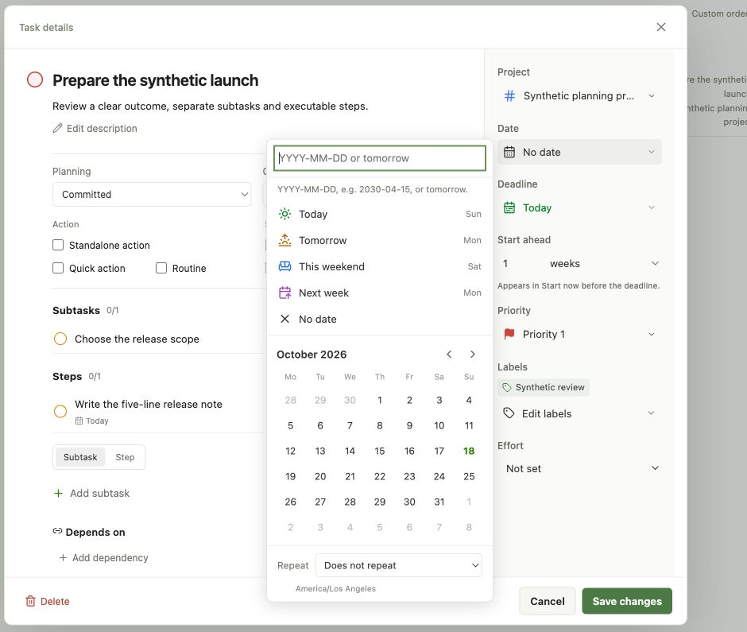
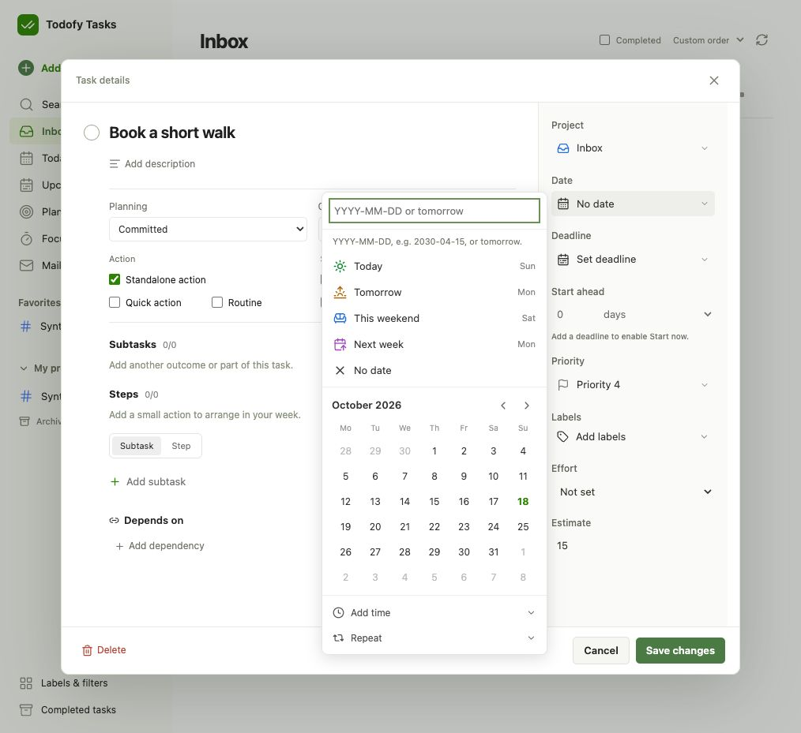

# Tasks workflow refinement

The owner's 28 requested changes are the acceptance scope. The implementation separates generic Tasks
content, Todofy planning facts and FlowDay queues/timing. No VPS, Newsletter or Recall product changes are included.

## Acceptance

Implementation `2dbd6aad31d7876a2a609ac3e172612f5d9f5616` passed the complete
[branch gate](https://github.com/ziyixi/todofy/actions/runs/39102347298) and the
[same-SHA main release](https://github.com/ziyixi/todofy/actions/runs/39102825081).
The owner confirmed the full production cleanup scope on 2026-10-18; it has been applied and verified.
Private cleanup inputs remain outside this public repository. Items 23–26 passed branch CI
[39110446990](https://github.com/ziyixi/todofy/actions/runs/39110446990) and the same-SHA main release
[39110769544](https://github.com/ziyixi/todofy/actions/runs/39110769544) at
`f5745def60865a832781727bb71919754ee23b0e`; owner Chrome confirmed the deployed controls.
The release receipt for items 27–28 is in [the October 18 handoff archive](../../docs/history/handoff-2026-10-18.md#tasks-workflow-refinement-2026-10-18-utc).

| Item | Required result | Evidence |
| --- | --- | --- |
| 1 | Counts beside Inbox, Today, Upcoming, projects, labels and filters | Real D1 aggregation tests cover open/archived tasks and filter/date scope. |
| 2 | Redundant Mail favorite and separator removed | Exact Mail favorite unfavorited and separator filter retired; production UI shows no obsolete Favorites section. |
| 3 | Empty Planning settings removed | Destination/component removed; old settings bookmark opens Plan. |
| 4 | Projects managed from sidebar | Catalog contains Labels & filters; archived projects remain accessible. |
| 5 | Dependencies are native; obsolete DAG status tags removed | Empty derived-status tags retired. Existing metadata contained no dependency declarations; no edges were invented. Named native dependencies and completion/unblocking pass browser checks. |
| 6 | Obsolete reminder/test labels removed | Memberships removed and exact obsolete labels retired. |
| 7 | Native Deep/Shallow effort | Additive Tasks schema, copy/write/read and real D1 checks. 163 Deep, 119 Shallow and the one conflict left unspecified are verified in production. |
| 8 | My projects collapse works | Browser/UI checks include persisted collapse and restored projects. |
| 9 | Empty search has no API error | Empty requests are skipped; clearing a pending query prevents stale results. |
| 10 | Stored legacy key suffixes removed | 222 task titles cleaned, including the embedded key in the same target set; zero markers remain. Completion snapshots are unchanged. |
| 11 | Structured Repeat controls | Real D1/browser save/reload covers weekly intervals, weekdays, completion-relative and monthly rules; unit checks include yearly month/day. |
| 12 | Clock belongs to Steps or explicitly standalone actions | Ordinary editor hides Time; Step local time persists with the account zone. Context-menu browser checks also save only the date for ordinary Tasks. |
| 13 | Deadline minus selected days/weeks controls Start now | Native custom 0–365-day window, real Core/Tasks D1 test; ordinary dialog save/reopen retains it. |
| 14 | Standalone action makes a Task schedulable | Native flag mapping fixed; only explicit action/Step eligibility is used. The two existing queued ordinary tasks now have explicit Standalone facts; all queues are unchanged. |
| 15 | Blocked names prerequisites | Editor shows named dependencies and current completion state. |
| 16 | Compact visible Plan options | No collapsed Task options section; native controls share existing planning actions. |
| 17 | Ordinary task editor exposes options, children and Deadline | Synthetic Chrome check and real D1 browser journeys. |
| 18 | Delete child from parent | Inline confirmation removes only the selected child; parent/sibling survive reload. |
| 19 | Separate Subtasks and Steps | New kind is explicit; only verified old AppendSteps receipts qualify for backfill. Four receipt-proven children were backfilled; plain descendants were not inferred to be Steps. |
| 20 | Start ahead always visible | In the normal properties rail, beside Deadline; no More details click. |
| 21 | Dependencies drive Blocked | Separate Blocked checkbox removed. Unknown/deleted and reopened prerequisites are distinguished. |
| 22 | Focus uses FlowDay timer | Shared count-up/25/50-minute mode, server settlement and wall-clock rendering; completion replay, parent-cascade and unrelated-timer checks pass against existing APIs. |
| 23 | Stable task-detail loading | Real browser regression holds planning and child reads separately: the frame stays 860×780, with no guessed unchecked flags. |
| 24 | Deliberate action/status placement | Action/Status groups align across both editors; wide/narrow layout checks preserve 14px controls. |
| 25 | Date/Deadline format guidance | Shared picker shows supported ISO/tomorrow examples; local parser, both entry-point browser checks and deployed Chrome checks pass. |
| 26 | Floating label picker | Existing Base UI popup floats outside the body; dimensions stay unchanged, multiple selections persist, Escape/outside clicks keep the editor open. |
| 27 | Faster repeated detail reads | A bounded 30-second page-memory cache reuses full task/planning replies. Real browser tests cover full descriptions, reopen reads, invalidation, edited drafts, stale writes and opening races. |
| 28 | Reduce unnecessary D1 work | Metadata-only Catalog, indexed counts, one Catalog per planning request and no-op saves. Real D1 row metrics and unchanged count semantics are checked below. |

## Synthetic Chrome evidence

The dedicated loopback preview uses real Tasks Worker/D1 for content and a synthetic planning/FlowDay
transport. It proves the visible interaction and task persistence; it does not prove a production timer.
The owner's real tasks were not edited for these screenshots.

A real Chrome check found nested date-panel CSS incorrectly sizing recurrence checkboxes. Direct-child
selectors fix the cause. A 1080-pixel browser regression now checks the popup, all weekdays and the
completion-relative control fit without horizontal overflow.

## Local checks

- Tasks Worker: type/lint, 2 unit and 36 real workerd/D1 tests, including the existing CPU check.
- Tasks web: type/lint/build and 39 Chromium journeys against local D1; separate hook/unit coverage
  includes source completion response loss and a failed post-completion refresh.
- Migration/deployment tools: 25 synthetic checks, including ID/history preservation.
- Core native Tasks integration: 18 real runtime checks; exact recurring completion replay stays at one
  occurrence and a parent completion settles only a proven completed descendant.
- Gateway: 143 unit checks; direct Focus SETTLE remains refused by the proxy.
- Proto: format, Buf lint, AIP lint, breaking comparison against the branch base and generated schema check.

## Production release and UI (2026-10-18 UTC)

The release independently verified Worker versions and persistent identities before recording these receipts:

| Application | Verified Deployment | Worker version |
| --- | --- | --- |
| Tasks | 7150745728 | `c8dce429-8ab7-48c9-954d-67d8966f39f0` |
| FlowDay | 7150757426 | `5ad78e1e-7aae-49a6-a0fb-7a4909902679` |
| Todofy Core / Gateway | 7150769623 | `242ef20c-4ed8-4f4f-94ce-a2bcff79540a` / `8f61bf0e-9db2-4ef3-b7d6-24ee5819b747` |

Owner Chrome confirmed 21 actual category badges, no empty-search error, the Labels & filters destination,
no Planning settings link, and My projects toggling true → false → true. A newly created, explicitly
synthetic ordinary task saved and reopened with Committed, Personal, Standalone action, Deep work,
tomorrow's Deadline and a one-week start window. Independent limited D1 reads confirmed `kind=task`,
`effort=deep`, the exact deadline, and a separate planning row with `lead_days=7` and `task=1`.
The synthetic task was immediately soft-deleted in the UI. It was never scheduled, completed or timed;
no real task was moved for acceptance. The production timer was idle before this check.

The complete local UI suite passed 39 browser journeys, and the final web unit suite passed 37 checks.
Native timer behavior was verified against real local FlowDay/D1, including expiry/reload and exact
completion replay through Core. No production timer mutation is claimed.

## Production cleanup (2026-10-18)

The owner confirmed the concrete full scope. A fresh private plan matched 312 task rows: 222 task titles,
163 Deep and 119 Shallow facts, one conflict set to unspecified, and four receipt-proven Steps. Eight
obsolete labels were retired, the exact redundant Mail project was unfavorited, the separator filter
was retired, and two already-queued ordinary tasks gained Standalone action. Remaining legacy labels
and key markers are zero; no source Todoist data was changed.

The final comparison preserves every task ID, parent/project identity, business date, estimate and all
2,824 completion occurrences. Owner API reads of 25 FlowDay flows, 103 queue references, 15 completed
queue references and 80 time entries are identical before and after cleanup. The native dependency
set is unchanged. Production Chrome shows no obsolete Favorites section, label or filter.

The operator initially wrote Tasks update/delete metadata in Core's seconds. The exact frozen target
rows were corrected to Tasks milliseconds and checked, without changing business dates or completion
history. Its UPDATE triggers appended valid current events; existing changefeed events, sequence and
consumer cursors were retained. The title verifier also found an embedded key after removing the trailing
suffix on one approved task; that key is now gone. The final metadata and content checks pass.

## Detail UI follow-up (items 23–26)

Implemented on `codex/tasks-details-polish`, using the existing React/Base UI components and services.
The detail frame is viewport-bounded and its body scrolls. Planning placeholders have the same height
as loaded controls and expose no guessed checkbox values. The compact Add task form keeps its original
layout while a saved generic task waits for the separate planning write.

Options are organized as Action and Status; the standalone choice has a deliberate first row. Both the
ordinary editor and shared Plan editor use the same visual grouping. Date and Deadline inputs show
`YYYY-MM-DD or tomorrow`, a concrete example and an accessible description. Calendar shortcuts remain.

Labels use a positioned popup in the native dialog's top layer. Opening it changes neither the frame
nor the body scroll height. Search, multiple selection, Escape, outside-click dismissal and existing
save behavior remain. Tests cover the detail and compact form, plus a short and narrow viewport.

Final local checks pass: 37 Tasks web units, 44 Chromium/local-D1 journeys, web lint/type/build,
22 shared planning units and 308 retired-consumer regressions. Actual owner Chrome with a synthetic
local fixture measured an unchanged 860×780 frame and body scroll height 677 with Labels open;
Escape dismissed only the popup. The following screenshots contain synthetic content only.

The branch gate and same-SHA release listed above completed. Read-only production Chrome inspection
confirmed an unchanged 860×780 detail frame, deliberate option groups, both date hints and a label popup
that left the 664-pixel body unchanged. These four changes added no credentials, schemas or infrastructure.

## Detail reads and D1 budget (items 27–28)

Detail reads use one page-memory map, at most 20 entries for 30 seconds. It holds only full GetTask and
single-task planning replies, never the reduced ListTasks projection. Concurrent opens share a pending
read; an expired pending read can be replaced on the next user action. A late reply cannot repopulate a
cleared entry or replace a more recently opened task. Nothing is persisted in cookies or local storage.

Writes, authentication failures, conflicts, window focus and visibility changes clear these entries.
They do not replace a draft already being edited. Planning mutations still read current state, preserve
unmodified remote fields and reject a conflicting deadline before applying start-ahead changes.
Saving an entirely unchanged task and planning draft performs no mutation or category-count reload.

Catalog retains task counts by default, including for old clients. Core and FlowDay explicitly omit them
when they only need organization metadata. A planning request reuses that metadata within the request;
the next request reads it again. Project and Inbox counts use existing indexes; there is no new index,
server cache, dependency, scheduler or quota service. Deployment order remains Tasks → FlowDay → Todofy,
so new consumers cannot send the optional field to an old strict decoder.

Measured with real Miniflare/D1 result metadata, using 40 active tasks and 2,000 completed tasks:

| Catalog read | SQL statements | Rows read | Rows written |
| --- | ---: | ---: | ---: |
| Before | 7 | 4,254 | 0 |
| Full counts after | 7 | 179 | 0 |
| Metadata only | 4 | 10 | 0 |

With label memberships present, increasing completed history from 2,000 to 4,000 leaves the counts
identical and reads unchanged at 298. These are synthetic query measurements, not production daily usage.
The tests assert the metadata-only budget and bounded history growth; ordinary writes still retain their
existing request receipts, etags and changefeed behavior.

Cloudflare documents account-shared Free allowances of 5 million read rows and 100,000 written rows per
UTC day, plus 5 GB total storage. Scanned rows count even when a query returns fewer results; indexed writes
also contribute. The Free per-database limit is 500 MB and the per-invocation query limit is 50. See
[D1 pricing](https://developers.cloudflare.com/d1/platform/pricing/) and
[D1 limits](https://developers.cloudflare.com/d1/platform/limits/). These local reductions do not guarantee
that every application in the account stays below its combined quota.

The final local suite includes 55 Tasks web unit/hook checks and 47 Chromium/local-D1 journeys, Tasks
Worker's 2 unit and 40 runtime checks, FlowDay's 21 unit and 6 native runtime checks, Core's 50 host and
19 real cross-language runtime checks, and proto format/lint/type/schema/breaking checks. Browser coverage
includes zero-write unchanged saves, full-description reuse, focus/visibility invalidation, real etag
conflicts and a late task-A reply after task B opens. Unit/hook checks cover cache expiration.

The initial branch run stopped at an unchanged Recall WebKit fixture's foreground assertion. Its setup
now brings the diagnostic page forward, awaits navigation and advances from the actual focus start.
All 16 existing WebKit cases pass against a freshly built current-source extension; product code and
capture/upload/dedup assertions are unchanged. Earlier local failures against stale ignored output are
excluded from current-version evidence.

During this work the owner reported an approximately 20-second refresh stall. Public HTTP reached Access
in about 0.1 seconds; authenticated Chrome inspection also stalled, then the same tab recovered without
cookie clearing or an application restart. The cause was not established. These read optimizations are
not evidence that the separate stall has been fixed.

## Warm-open layout follow-up

The owner subsequently reported an inward flash on a cached second open, localized to Depends on.
A real Chromium/local-D1 test reproduced two independent movements: child loading placeholders replaced
by empty instructions shifted the dependency heading upward 27.2px; removing the separate dependency
loading paragraph shifted it another 17.4px. The outer dialog stayed fixed, so the previous outer-frame
assertions did not detect this. Both response boundaries now preserve the heading position and section
height. Dependency reads remain fresh; there is no new graph cache or retry.

The same review found that cold task deep links could render before project/label metadata arrived,
temporarily showing Inbox and missing selected labels. The detail dialog now waits for the existing
Catalog readiness condition. A regression holds Catalog independently from the full task response and
checks the correct project and selected labels on the first visible editor.

Date opens with its calendar and compact Time/Repeat entries. The controls expand only when requested;
existing time/recurrence summaries and stored values remain. Closing an expanded popup keeps its contents
until its fade completes, then the next open starts collapsed. The previous close-time state reset was
observed to shrink the popup by about 67px during the fade; its browser regression now checks that boundary.

Layout checks cover task details and Quick Add, Project/Priority/Date/Deadline/Labels on first/repeated
open, and the catalog color picker. They compare internal geometry and scroll position as well as the
parent frame; static popups are sampled across successive rendered frames. Existing interaction checks
still verify real saves, date rules and recurrence. The Tasks agent rules now require these checks for
future dialog/popover changes. Intentional expansion is distinct from loading-induced movement.

The sidebar resize hit area stays unchanged; its hover/focus feedback is a short central line instead
of a full-height rail. Application/backend contracts, database rows and installed extensions are unchanged.
Local combined checks, same-SHA branch/main release and production inspection are recorded in
[the October 18 handoff archive](../../docs/history/handoff-2026-10-18.md#tasks-workflow-refinement-2026-10-18-utc).

Actual Chrome with a synthetic local task shows the default collapsed date controls:

