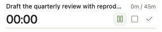
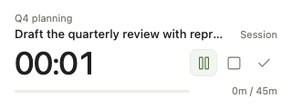
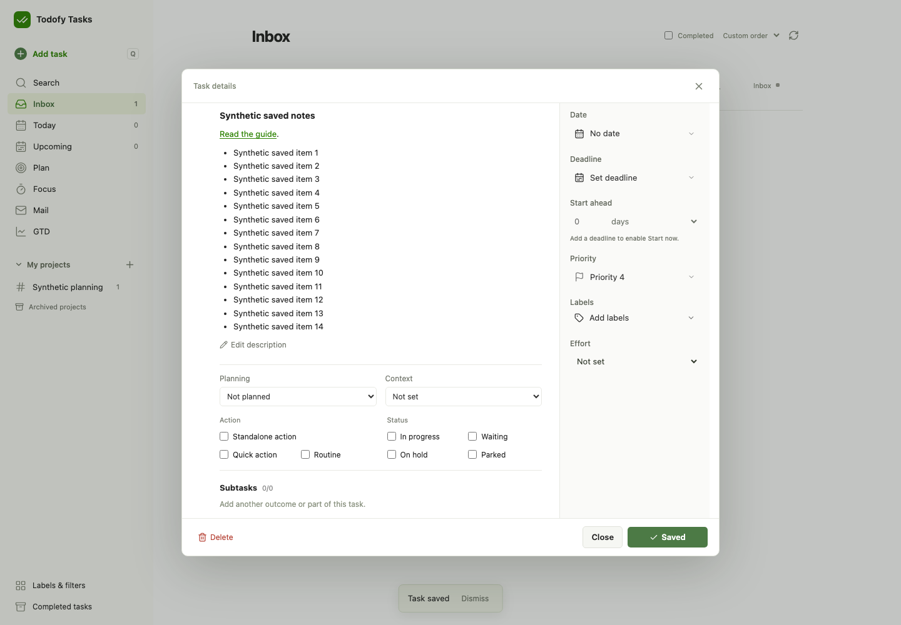
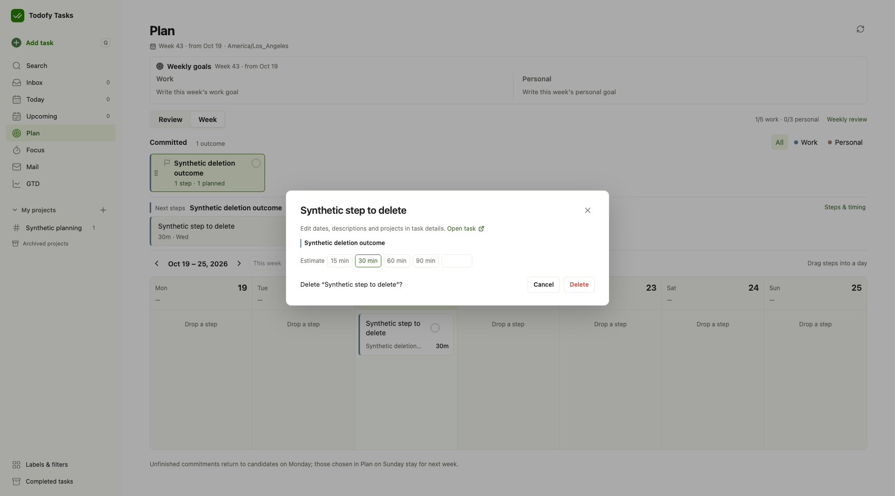

# Tasks UI review, 2026-10-22

This review uses the Product Design audit workflow on the existing Tasks interface. All screenshots contain
synthetic local tasks. The familiar colours, page layout and Task/Step hierarchy stay in place.

## 1. Focus and the floating clock

The main Focus screen already separates the parent outcome, executable Step and its area clearly. Its timer
bar needed a slightly stronger clock, not a new layout. The clock now uses a 23px medium-weight tabular font.

The 64px-high floating window hid the Step title and its controls at rest. It left a number without enough
context. The updated window keeps the title, makes Pause/Resume, Stop and Complete visible, and shows the day's
recorded time plus this session against the estimate. Taller windows also show the parent outcome. Each icon
uses the existing Lucide library and has a text tooltip and keyboard focus outline.

Before, at 320 × 64:

After, at 320 × 64 and the default 320 × 120:

Running, paused/resumed and hour-long sessions were checked in real Chromium Document Picture-in-Picture at
320 × 64, 320 × 120, 260 × 100, 420 × 180 and 420 × 240. The checks cover internal bounds, overlap, title visibility,
idle controls and time overflow. The 180px breakpoint with a long title fits in the actual renderer; no extra
layout branch was added for the theoretical overflow raised in source review.

The native Mac Chrome preview also verified its remembered 320 × 64 size, 320 × 120, Pause/Resume and closing
through the Mini timer toggle. Description Done and its rendered Saved result were checked there as well.

The existing timer commands, persistence, background behaviour, Pomodoro and away-time handling remain in use.
Only the small clock component ticks; this change adds no server reads, local timer storage or dependencies.

## 2. Task editing

Save keeps the task dialog open and changes the same button to a check and Saved. The button has a stable
footprint, so neither the footer nor the body shifts. Viewing unchanged content keeps the confirmation;
editing clears it. A polite live status also announces the result.

Description Done now saves the current task draft, including other pending task/planning changes, through
the existing single write. A failed write leaves the description editable and keeps its draft. The existing
Markdown renderer loads with the dialog code, so it no longer swaps raw Markdown for rendered content after
opening. Headings, lists, tables and links retain the existing safe renderer's behaviour.

Browser checks read the saved task from local D1 immediately after Done, before any footer Save. They also
cover failure, cached reopen, fresh etags and the positions of the footer, controls and planning fields, plus
scroll position. A first run caught Save changes wrapping into two lines; a fixed 128px non-wrapping button
resolved it without relaxing the geometry assertions.

## 3. Plan

Quick actions retain their existing Due selection and ordering. A Deadline now also gates the Quick tray:
an item appears when its start-ahead window opens, or on the Deadline day if lead time is zero. Already active
work stays available. Undated items without a Deadline retain their current behaviour.

The Step's estimate panel now has Delete step with an inline confirmation. It calls the existing native
DeleteTask, then refreshes Plan/Focus. There is no detour through the full task editor or separate deletion
workflow. Tasks retains its existing handling of day queues, dependencies and recorded time. A real local D1
journey verified deletion returned 200, the task then returned 404, its Plan/day-queue entries disappeared and
its existing 15-minute time record stayed unchanged. A separate browser check verified Quick visibility on
both sides of the start window.

## Verification scope

The review covers these desktop flows, rather than every Tasks screen or a full accessibility audit. Small
PiP controls are at least 24px in the checked sizes, have accessible names and visible focus indicators.
Keyboard and geometry regressions complement the screenshots; screenshots alone do not establish screen-reader
or full contrast compliance. Existing synthetic tests cover timer lifecycle and away-time choices.

This is a frontend/shared-planning change. It changes no schema, stored history, real tasks, resources,
credentials, budgets or processing switches. Deployment evidence belongs in HANDOFF and the normal Actions run.
