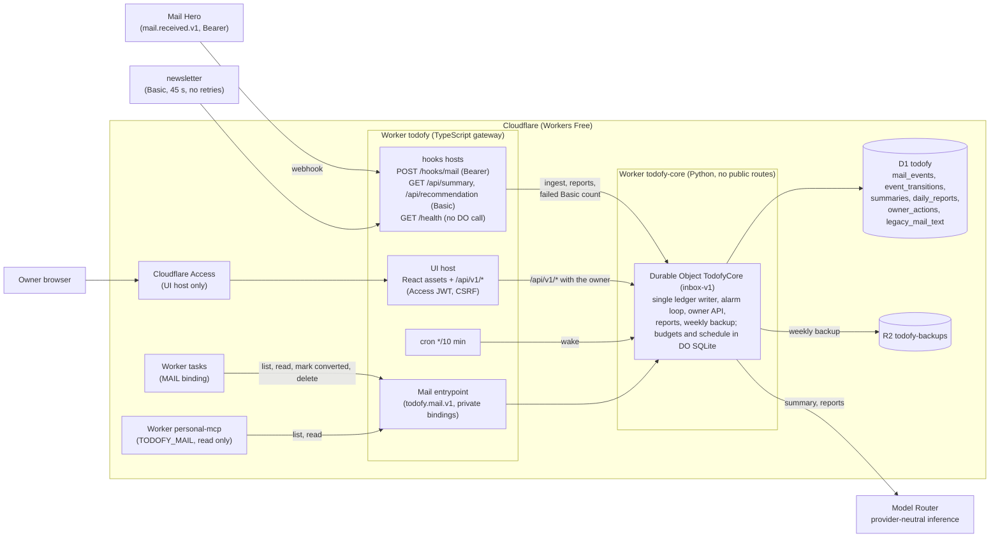
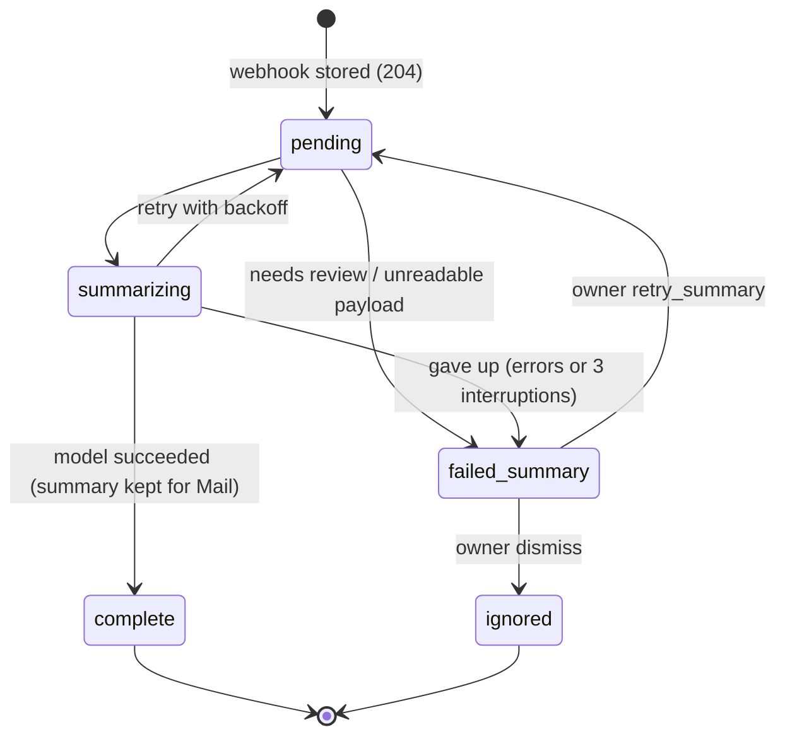

# Todofy architecture

Two Cloudflare Workers on the Workers Free plan: a thin TypeScript gateway (`todofy`) and a Python
Worker (`todofy-core`) that hosts one SQLite-backed Durable Object, plus one D1 database and a private R2
bucket for its weekly backups. Mail Hero delivers each received mail as a `mail.received.v1` webhook; Todofy
summarizes it through Model Router and keeps the summary for Tasks' Mail page, where the owner turns it into a task, and
serves a daily summary and recommendation to the newsletter. It writes and reads no task and binds no other app:
Tasks reads the mail and marks it converted through the gateway's private `Mail` entrypoint. The owner UI is a
React app served by the gateway behind Cloudflare Access. The gateway only checks credentials and routes (a plain
Worker request has 10 ms of CPU); everything that touches D1 or model invocation runs in the Durable Object (30 s per call).

Event lifecycle (one ledger step per alarm; every step is a compare-and-set on `(state, version)`). A
summary completes the event. The states of the old per-mail task path (`summarized`, `todo_sending`,
`todo_unknown`, `todo_created`) stay in the schema for stored rows; migration `0014_retire_task_writes.sql`
required none to be live when Todofy stopped writing tasks (2026-10-21):

