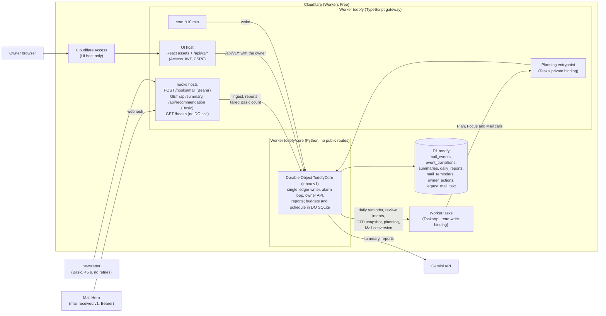
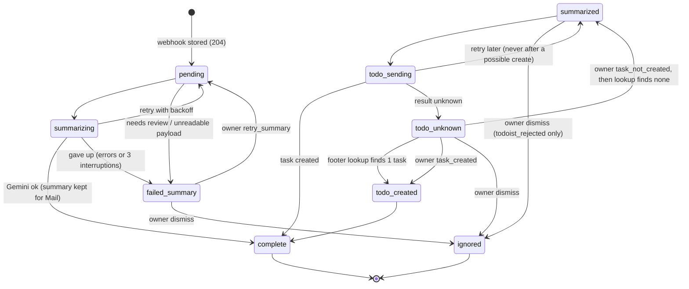

# Todofy architecture

Two Cloudflare Workers on the Workers Free plan: a thin TypeScript gateway (`todofy`) and a Python
Worker (`todofy-core`) that hosts one SQLite-backed Durable Object, plus one D1 database. Mail Hero
delivers each received mail as a `mail.received.v1` webhook; Todofy summarizes it with Gemini and keeps
the summary for Tasks' Mail page, where the owner turns it into a task, and serves a daily summary and
recommendation to the newsletter. It writes its own tasks (reminders, weekly reviews, task intents) to Tasks
through the read-write `TASKS` binding and keeps Tasks' planning facts. The owner UI is a React app served by
the gateway behind Cloudflare Access. The gateway only checks credentials and routes (a plain Worker request
has 10 ms of CPU); everything that touches D1, Gemini or Tasks runs in the Durable Object (30 s per call).

Event lifecycle (one ledger step per alarm; every step is a compare-and-set on `(state, version)`). A
summary completes the event; the `summarized` → `todo_*` path only finishes task requests frozen before the
2026-10-17 cutover to Tasks:

