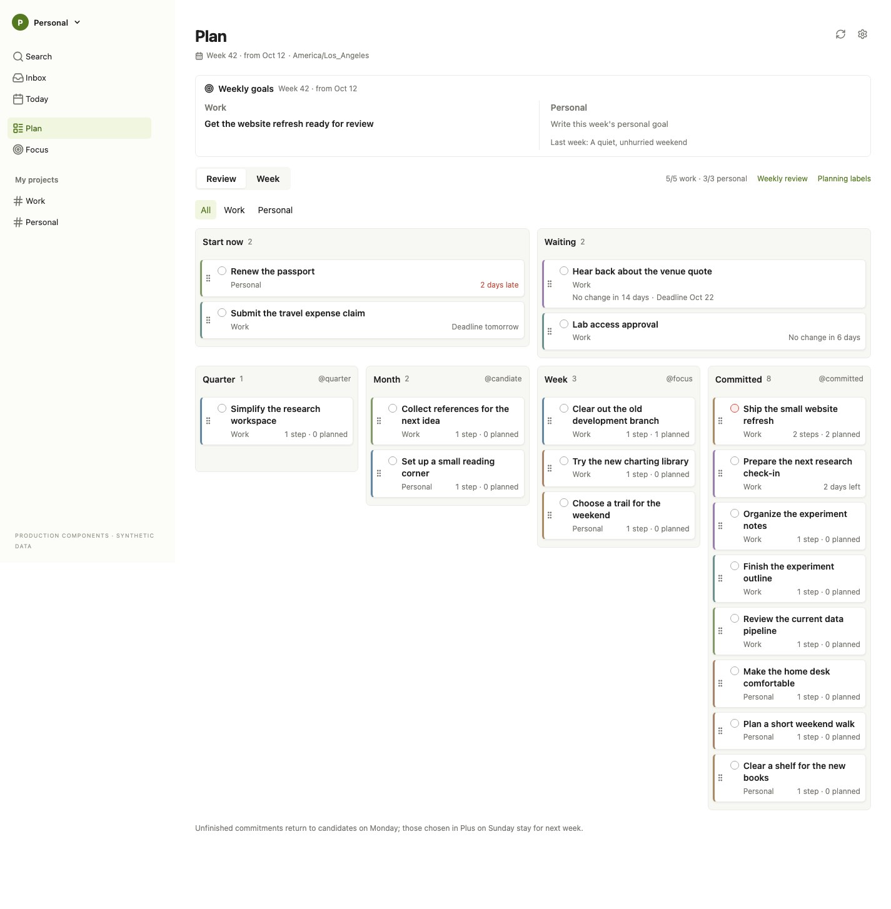
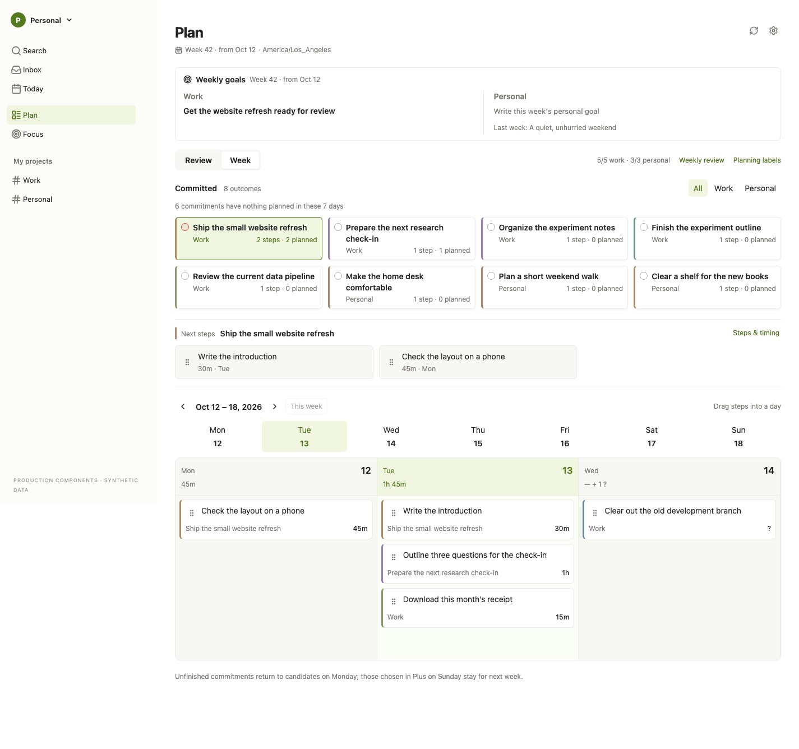
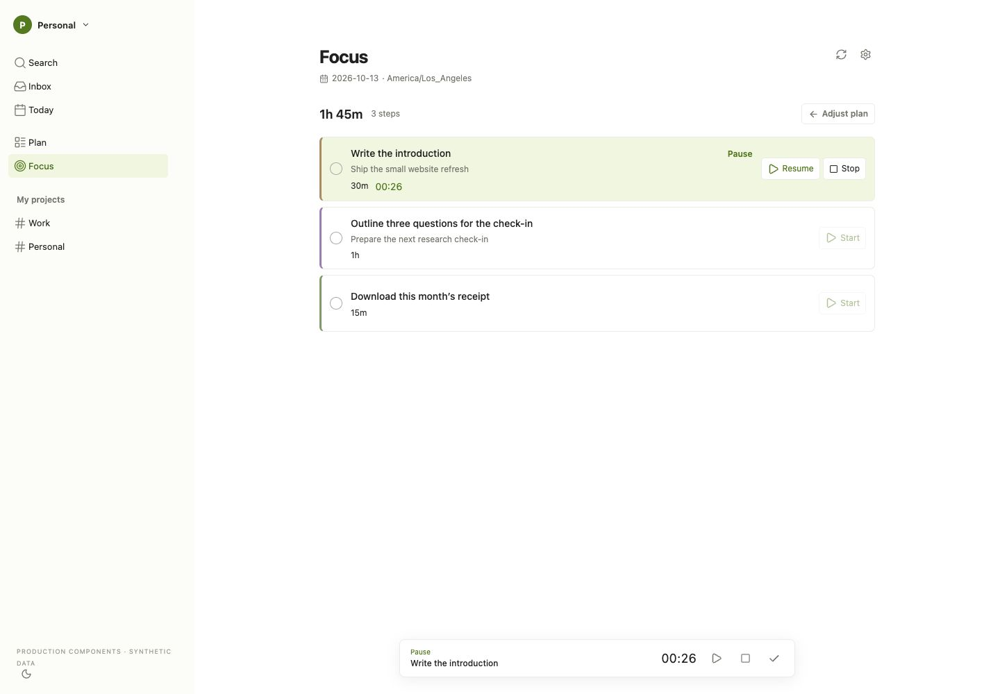
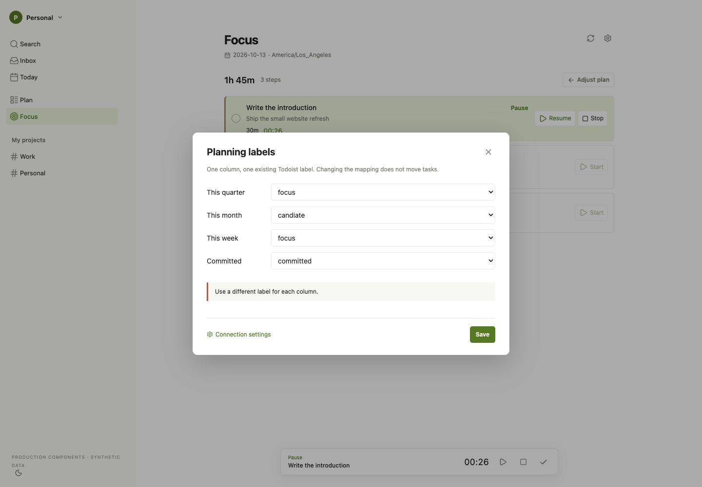
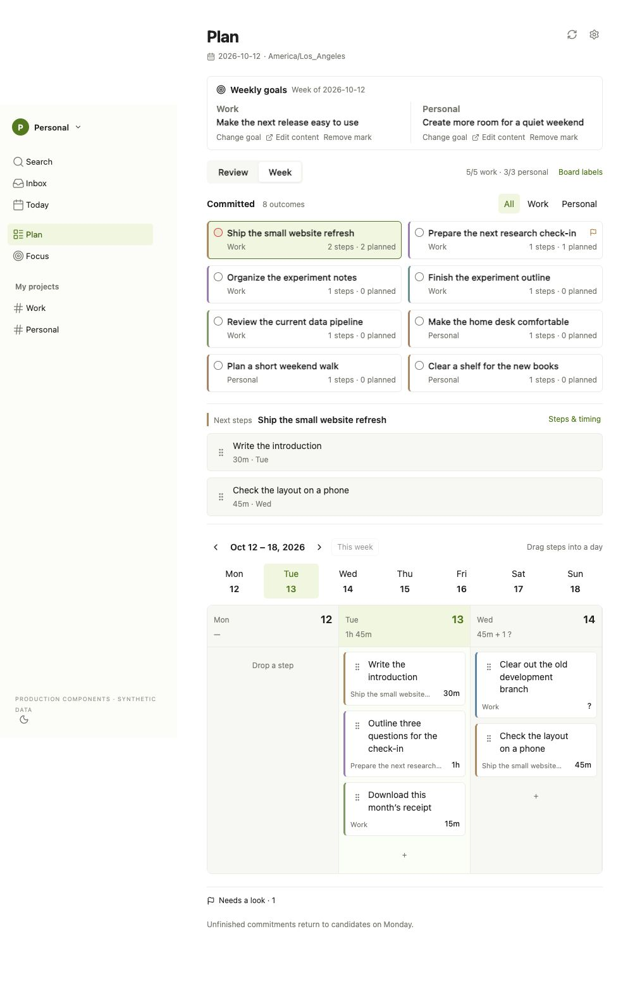
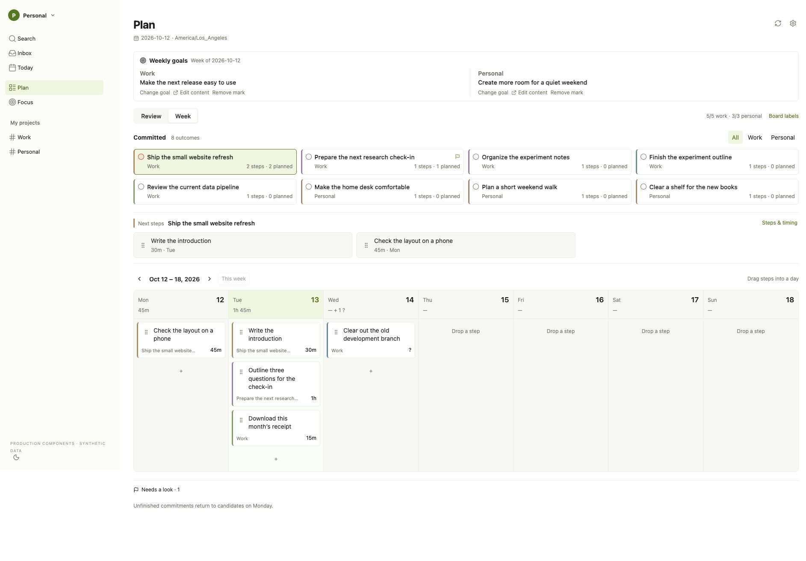

# 规划界面与接口说明

## 使用目标

用户把较大的事项分成可执行的小步骤，每周决定承诺，再把步骤安排到某天。界面应减少移动标签、查看父任务和在多个应用间切换的劳动。具体做什么仍由用户选择。工作最多五项、生活最多三项是提示，不拒绝操作，也不代替周末回顾。

## Plan 的组成

Plan 顶部保留当前账户周的整体目标，下方有 Review 和 Week 两个视图。默认 Review 和 All，工作／生活过滤不改变真实标签。浏览另一周只影响 Week 的日期队列，不把当前承诺或整体目标伪装成历史快照。

### 本周目标

Work 和 Personal 各显示已有最高层 Bet 任务。Bet 的定义是本周整体目标，与 Committed 事项独立。多个 Bet 全部显示并提醒；未分类目标放在单独的可见区域。界面不自动挑选、清除或合并目标。

“更换目标”打开一个小型选择框，在已完整读取的活动任务中按标题或父任务搜索。选择现有任务，只移除原目标的 Bet 标记和增加新目标的 Bet 标记，保留规划范围、其他标签和日期。更换后合并两个确认的任务，不再完整读取。要修改实际标题，用原生 Todoist 的编辑入口。关闭、Escape 和点击弹窗外均退出选择。

### Review

四列按顺序表示 Quarter、Month、Week、Committed。列标题同时显示它对应的当前 `@label`。Month、Week、Committed 使用明确绑定的标签；Quarter 可以不绑定，未绑定时不接受该范围的写入。

事项卡按以下顺序阅读：标题、工作／生活上下文与步骤及排程数量。Todoist 优先级保留其原值，整体目标不再以每张承诺卡的星标呈现。标题点击打开任务详情；单独抓手拖动卡片。落到同一列无变化，跨列仅调用该任务的规划范围写入。卡片不通过标签移动整棵子树。

“标签对应”选择当前已存在的 Todoist 标签，不能输入一个不存在的标签名。每列选择不同 ID，保存检查元数据 etag。更改映射影响后续投影和操作，不搬动已有任务。设置面板点击外部、Close 或 Escape 关闭。连接管理仍回到已有 owner 页面。

### Week

上方紧凑总览显示当前 Committed 事项。默认展示全部，工作／生活过滤保持可选。点击一个事项展开它的小步骤，再从步骤托盘拖入日期。没有独立规划标签的中间层级和仅因日期进入候选的子步骤继续属于父事项；显式使用不同范围标签的子事项按自身范围处理。日期与真实标签不重写。

步骤卡先显示标题，下方显示短所属事项和估时；父事项与步骤共用由事项 ID 派生的色标。事项卡标题最多两行，完整名称可在详情查看。步骤卡按内容排布，不按估时把普通卡片拉成占满屏幕的长块。实际数据没有额外保存色彩设置或像素布局。

日期队列保留原始顺序、本地任务、杂项与已完成 ID。托盘拖动给目标日增加安排，同一小步骤可以安排在多日；拖动日历中已有卡片才从原日移到目标日。投放到卡片前表示插入到它前面；投放到列底部表示追加；同日抓手调整顺序。跨日移动先确认源／目标队列，再在目标位置插入。落下后卡片立即显示在新位置并等待确认，见[写入与读取](#写入与读取)。已运行或暂停的步骤需要先停止计时。

日历显示上一周、下一周、回本周。宽窗口显示七日，中等窗口显示三日，窄窗口显示单日；上方日期按钮仍可选日和投放。显示其他周不修改任务 Due 或 Deadline。日期队列变更不修改规划列。

## Focus 与计时

Focus 显示真实今天的未完成 FlowDay 队列，顺序与 Week 相同。卡片标题在上方，短所属事项、估时和计时信息在下方。空队列只有“调整计划”入口，不出现另一套任务挑选器。

每个 Todoist 步骤显示独立的完成控件和 Start 按钮。运行后显示确认的经过时间及 Pause、Stop；暂停后显示 Resume、Stop。Stop 保存计时但不完成任务。完成操作先由 Todofy 确认 Todoist 结果，再结算对应 FlowDay 日期。

FlowDay 本地记录保持标题、估时和原应用入口，不创建 Todoist 完成请求。旧日期的活动计时不冒充今天同名 ID 的活动计时，也不允许今天另启一段覆盖它。全局计时条在 Plan／Focus 切换时保留，不新增浏览器本地计时存储。

## 样式与交互约束

| 项目     | 约束                                                                                   |
| -------- | -------------------------------------------------------------------------------------- |
| 挂载     | 使用现有 WXT Shadow DOM，导航与字体起点对齐原生 Todoist                                |
| 标题     | 14px，先于上下文，完整内容可在详情查看                                                 |
| 次要内容 | 12px，简短所属事项和估时保持可读                                                       |
| 拖动     | 现有 `@dnd-kit/react`，抓手与标题点击分开，160ms 落下动画                              |
| 反馈     | 可接受区域着色，卡片前插入显示位置；拖动与移出只让该卡等待，其他写入确认前停用写入控件 |
| 错误     | 原有错误区域显示实际失败；撤回全部等待中的变化并重新读取，不伪装操作成功               |
| 主题     | 使用当前 `--plus-*` 变量，保留浅色和深色主题                                           |
| 模态框   | Close、Escape、点击框外关闭；不依赖浏览器原生确认弹窗                                  |

Plus 只按已知真实对象 ID 隐藏被替代项。收藏项目保留，其他标签和筛选器收在 Other views。Quick 的现有筛选器仍可从这里访问，Plan 不将它声明为已替代。禁用扩展并刷新恢复原控件，不删除 Todoist 筛选器、标签或收藏。

## 写入与读取

2026-10-15 owner 批准：拖动先显示、按序保存，只对下列拖动与移出放宽“写入期间禁用写入控件”。

- Review 跨列拖动、Week 拖入日期、跨日移动和同日排序落下后，卡片立即显示在预期位置。只有这张卡等待：变暗、小转圈、不可拖动，移出按钮隐藏。其他卡片、切周和下一次拖动照常可用。
- 等待中的卡片在可访问名称中带“正在更新…”；抓手用 `aria-disabled` 停用但保持可聚焦，键盘落下后焦点留在移动的卡片上。减少动态效果时小转圈停止，只保留变暗。
- 等待中的 Review 卡仍带拖动前的 etag：它的详情、本周目标的移除标记和更换目标在确认或撤回前只读，详情标题显示同一等待标记；结束后显示服务端保留的规划范围。
- “移出日期”不提前删除：卡片原位等待，FlowDay 确认后才消失。
- 所有写入进入同一个先进先出队列，按操作顺序执行。FlowDay UpdateFlow 没有 etag、后写覆盖先写，所以移出日期和加入今天在执行时先 GetFlow 读取当前队列，只增删这一项，不写回屏幕上可能过时的队列；其他标签页刚加入的步骤和排在前面的移出都会保留。Todoist 写入仍检查 etag。确认后换成服务端返回的任务或队列。
- 任一写入失败时，排在其后的写入不再发送，所有等待中的预期变化撤回；原有错误区域说明“更改未保存，已恢复”、实际失败和其后未发送的更改数，队列空闲后重新读取。等待中的卡片不显示为已保存。
- 完成、添加小步骤、估时、提前开始、详情中的规划保存、标签对应、本周目标、加入今天和计时仍先确认，写入期间停用写入控件。

读取不锁定看板，也不重复读取写入已返回的结果：

- 打开、刷新按钮、返回标签页（距上次完整读取至少 60 秒）和写入后需要的读取都在后台进行，只转动标题栏刷新图标。与写入重叠的读取作废，队列空闲后再读，旧读取不会覆盖较新的确认结果；两次读取重叠时，先发出的读取晚到也不覆盖后发出的结果。
- SetTaskPlan、SetTaskLead 的 PlanningTask、本周目标的两个确认任务和确认后的日期队列直接合并，不再读七天。UpdatePlanLabels 的映射直接合并；新映射会改变任务的规划范围投影和全部任务 etag，所以随后后台读取一次，读取完成前停用写入控件。
- 完成任务后仍重新读取，不在本地删除：Todoist 关闭循环任务时会推进到下一次。读取完成前该步骤等待，不能再次完成。
- 离开 Plan／Focus 时，上次确认的数据只留在当前页面内存中；返回时立即显示，再后台读取。它可能早于一次完成或跨过午夜，所以本次读取完成前不开放写入；这次读取失败时只显示错误，并丢弃这份内存数据。离开时显示本周的，返回后跟随服务端的当前周（含周一轮换）。
- 原生页面只调用 ReadPlan。background 把 `{configured, hiddenFilterIds, labelIds}` 只按 ID 存入 storage.local，不含任务内容；下次打开 Todoist 时侧栏立即按缓存整理。连接缺失或失效时（包括网关对未知或已撤销口令的 401）清除缓存并提示打开连接设置；断开或换连接后仍在进行的请求不再写回缓存或 FlowDay ID。原生任务详情使用一分钟内读取、且包含该任务的内存数据时只调用 ReadPlan；更旧的或缺少该任务的先显示，完整读取完成前不开放写入。保存失败（例如任务已在 Todoist 中修改）后完整重读，不再复用旧数据。
- FlowDay 手动同步成功后记住请求的任务 ID，并只把 ID 镜像到 chrome.storage.session；后台 worker 被 Chrome 停止后仍可跳过重复同步，避免 30 秒节流内失败。

## 数据与接口边界

根 IDL 为 `proto/todofy/ui/v1/plus_service.proto`，FlowDay 的队列与计时 IDL 为 `proto/flowday/ui/v1/flowday_ui_service.proto`。修改 IDL 后使用根工具链生成客户端，应用不保存另一份协议。

| 用户操作              | 既有接口／本轮扩展                                                                 | 确认结果                                              |
| --------------------- | ---------------------------------------------------------------------------------- | ----------------------------------------------------- |
| 加载                  | ReadPlan、完整 ListPlanningTasks、FlowDay ListTasks、七日 GetFlow、GetTimerSession | 元数据、任务、所选周队列和真实今天计时                |
| 原生页面              | ReadPlan                                                                           | 只按 ID 缓存配置，下次加载立即整理侧栏                |
| 改规划范围／Bet／领域 | SetTaskPlan                                                                        | 当前 PlanningTask，合并单任务                         |
| 更换整体目标          | 原目标和新目标分别 SetTaskPlan                                                     | 合并两个确认任务，不新增 Goal RPC                     |
| 保存列标签            | UpdatePlanLabels                                                                   | 带 etag 的精确标签映射，任务标签不改；后台重读投影    |
| 创建小步骤            | AppendTaskSteps                                                                    | 原 Todoist 父 ID 下的新步骤，后台再读取               |
| 同日队列              | UpdateFlow                                                                         | 确认后的目标 FlowDayPlan，直接合并                    |
| 移出日期／加入今天    | GetFlow 读取当前队列，再 UpdateFlow 只增删一项                                     | 确认后的该日 FlowDayPlan，直接合并                    |
| 跨日队列              | RolloverFlow，再 UpdateFlow 排列插入位置                                           | 确认后的源／目标 FlowDayPlan，直接合并                |
| 估时                  | FlowDay UpdateTask 的 estimated_minutes 掩码                                       | 现有手动估时，零表示清空                              |
| 计时                  | CommandTimer，etag 与稳定 request ID                                               | TimerSession 映射为 TimerSnapshot；idle 清除显示状态  |
| 真正完成              | CompleteTask，再结算 FlowDay                                                       | Todoist 确认后后台重新读取，不靠本地删除              |
| 提前开始              | SetTaskLead                                                                        | 确认后的 PlanningTask（Deadline、leadDays），Due 保留 |

background 持有连接口令，content script 只发送封闭的类型化消息。升级沿用原目录和 storage.local 的 connection，不重置口令。当前内部操作消息使用 planning protocol 3（写入返回确认结果，新增 ReadPlan，加入今天与移出日期改为单项操作）；旧脚本收到明确刷新提示，刷新 Todoist 后使用新语义。初次读取并行获取独立数据；切周只读七天队列。App 合并确认任务、标签映射、队列和计时响应，原有读取序号保护正在查看的周，Plan／Focus 切换不扫描所有任务。离开自定义页面进入原生 Todoist 后卸载，返回时先显示内存中的上次确认数据，再后台重新读取；读取完成前不开放写入。

## 实现文件

| 责任                  | 文件                                                       |
| --------------------- | ---------------------------------------------------------- |
| 整体页面与确认状态    | `src/App.tsx`                                              |
| 确认结果与预期变化    | `src/plan-updates.ts`                                      |
| 计时与等待标记        | `src/StatusMarks.tsx`                                      |
| 本周整体目标          | `src/WeeklyGoals.tsx`、`src/weekly-goals.css`              |
| Review 与事项卡       | `src/ReviewBoard.tsx`、`src/review-board.css`              |
| Week 事项总览与小步骤 | `src/PlanningWeek.tsx`                                     |
| 日期队列与投放位置    | `src/PlanningCalendar.tsx`、`src/planning-week.css`        |
| 所属事项与色标        | `src/planning-outcomes.ts`                                 |
| 标签对应              | `src/BoardLabels.tsx`                                      |
| 今日执行与计时按钮    | `src/FocusView.tsx`、`src/FocusBlock.tsx`、`src/focus.css` |
| 用户调用及服务端协议  | `src/api.ts`、`src/client.ts`、`src/background.ts`         |
| 原生 Todoist 挂载     | `src/mount.tsx`                                            |

## 验收与截图

原型、本地真实 MV3 构建包、CI、生产发布和真实账户验收分别记录。原型经过时间是合成演示，不能证明 FlowDay 的生产计时。生产路径浏览器检查使用真实扩展构建、临时 Chromium profile、独立协议响应和合成 Todoist DOM，不访问个人 Chrome 或私人任务。

2026-10-14 的截图来自 Chrome 中 `design/production.html`，直接渲染 `src/App` 和正式组件，所有任务、队列、标签 ID 和计时回执均为合成数据。这里的计时只证明组件处理确认状态；临时 Chromium 的真实 MV3/API 合成测试另行验证生产传输路径，不把截图当成生产 FlowDay 调用证据。

### Review 与整体目标

整体目标在看板上方。四列显示标签名称、步骤和排程计数；优先级和提前开始提示保留。

### Week 与父事项上下文

八项承诺集中展示，选中事项后出现步骤托盘。日期卡先显示步骤，再显示所属事项、估时和同色标记。图中是中等窗口的三日布局。

### Focus 与暂停计时

Focus 直接执行今日队列。暂停后显示 Resume／Stop 和固定的经过时间，全局计时条仍在。Stop 不完成任务。

### 列标签配置

下拉框只选择已有标签 ID。重复选择时保留面板并显示冲突，其他标签和任务保持原样。

### 窄窗口

1000px 的 Chrome 窗口无页面横向溢出，按日历可用宽度显示三日；更窄时显示单日。日期按钮和切周仍可用。

本地已验证：单元／组件／API 测试（数量见发布记录）、真实构建的 MV3 挂载与传输、四项看板／拖动检查和三项 Focus 检查。Chrome 的正式组件合成页面另外确认八项承诺、跨日移动、设置冲突、框外关闭、暂停计时及窄窗口无横向溢出。CI、生产身份与安装状态见根 [Plus 验收](../../docs/todoist-plus-verification.md)。

检查重点为 Bet 更换不改日期／范围、多个 Bet 不自动消失、跨列和跨日的不同写入、确认后队列一致、计时跨视图继续／暂停后固定／停止不完成、配置冲突和弹窗关闭。真实发布身份、截图和仍需 owner 验收的事项补入根 HANDOFF 与本应用验收记录。

宽窗口的七日全览：

