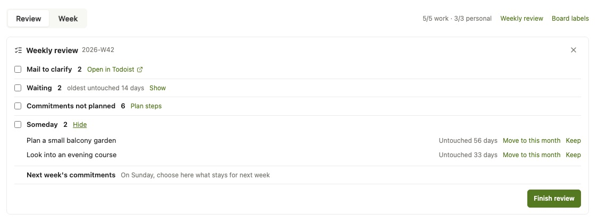
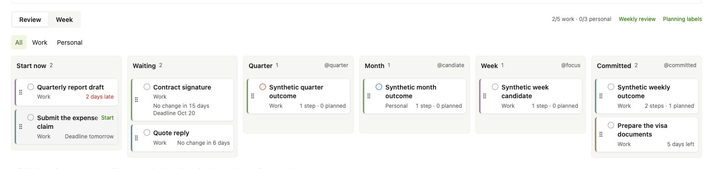

# 规划界面与接口说明

## 使用目标

用户把较大的事项分成可执行的小步骤，每周决定承诺，再把步骤安排到某天。界面应减少移动标签、查看父任务和在多个应用间切换的劳动。具体做什么仍由用户选择。工作最多五项、生活最多三项是提示，不拒绝操作，也不代替周末回顾。

## Plan 的组成

Plan 顶部保留当前账户周的整体目标，下方有 Review 和 Week 两个视图。默认 Review 和 All，工作／生活过滤不改变真实标签。浏览另一周只影响 Week 的日期队列，不把当前承诺或整体目标伪装成历史快照。

### 本周目标

Work 和 Personal 各显示已有最高层 Bet 任务。Bet 的定义是本周整体目标，与 Committed 事项独立。多个 Bet 全部显示并提醒；未分类目标放在单独的可见区域。界面不自动挑选、清除或合并目标。

“更换目标”打开一个小型选择框，在已完整读取的活动任务中按标题或父任务搜索。选择现有任务，只移除原目标的 Bet 标记和增加新目标的 Bet 标记，保留规划范围、其他标签和日期。更换后合并两个确认的任务，不再完整读取。要修改实际标题，用原生 Todoist 的编辑入口。关闭、Escape 和点击弹窗外均退出选择。

### Review

2026-10-16 owner 定稿：从左到右是“该开始／Start now”、“等待中／Waiting”和四个规划列 Quarter、Month、Week、Committed（本季度、本月、本周、本周承诺）。前两列没有卡片时整列不渲染；四个规划列始终显示，没有新标签页。规划列标题同时显示它对应的当前 `@label`。Month、Week、Committed 使用明确绑定的标签；Quarter 可以不绑定，未绑定时不接受该范围的写入。六列（或五列）在宽窗口排成一行。内容区窄于约 1,260px（五列约 1,050px）时，四个规划列仍按顺序排成一行，“该开始”和“等待中”在它上方并排、各占两列（只有其中一列时占满整行），从它们拖入规划列是直接向下；窄于约 800px 时每行两列（该开始｜等待中、本季度｜本月、本周｜本周承诺），再窄时一列。六列用同一种列和事项卡，样式相同。

每个任务只在一列出现，取第一条命中的规则（`src/review-lanes.ts`）：

1. 有自己的规划标签（quarter／candiate／focus／committed）：留在该列。它在等或该开始时，卡片用一句安静的状态说明，见[截止日期](#截止日期)和[等待中](#等待中)。
2. `@waiting` 或 `@blocked`，或在等另一个尚未完成的任务（[依赖](#依赖)）：等待中。
3. 启动窗口已开或已过截止，且不是进行中：该开始。只因 7 天日期规则（Candidate If）成为 Week 待选的任务也进该开始，不进 Week。
4. 其余按原有日期规则留在 Week。

小步骤不是所属事项那一列的卡片，即使带着同一个规划标签，它也只是事项卡里的一步；所以在等或该开始的小步骤在“等待中”或“该开始”有自己的卡。把这样的卡拖进所属事项的列时，它写入后仍会回到原列，于是这次投放不写入，卡片回到原处；从“该开始”拖入并标为进行中、或拖入别的规划列（在那里成为自己的卡）照常写入。

事项卡按以下顺序阅读：标题、工作／生活上下文与步骤及排程数量；在等或该开始的卡片把步骤数量换成一句 12px muted 状态。状态只有一段时在领域右侧；有两段（`12 天未变动 · 10月22日截止`）时在领域下方单独一行，太窄时在两段之间折行，行首、行尾都不留 `·`。拖动时浮起的卡片与原卡同宽同高（dnd-kit 按原卡设定浮层尺寸），也带抓手。Todoist 优先级保留其原值，整体目标不再以每张承诺卡的星标呈现。标题点击打开任务详情；单独抓手拖动卡片。落到同一列无变化，跨规划列仅调用该任务的规划范围写入。从“该开始”拖入任一规划列就是确认：同一次 SetTaskPlan 写入该列的规划标签和 `active`（账户没有 `active` 标签时只写规划范围）。从“等待中”拖入只写规划范围，不去掉 `@waiting`／`@blocked`，也不加 `active`。“该开始”和“等待中”不接受投放，落在上面的卡片回到原处。拖动都先显示、按序保存，失败时撤回，见[写入与读取](#写入与读取)。卡片不通过标签移动整棵子树。

“计划标签”选择当前已存在的 Todoist 标签，不能输入一个不存在的标签名。每列选择不同 ID，保存检查元数据 etag。更改映射影响后续投影和操作，不搬动已有任务。设置面板点击外部、Close 或 Escape 关闭。连接管理仍回到已有 owner 页面。

### Week

上方紧凑总览显示当前 Committed 事项。默认展示全部，工作／生活过滤保持可选。点击一个事项展开它的小步骤，再从步骤托盘拖入日期。没有独立规划标签的中间层级和仅因日期进入候选的子步骤继续属于父事项；显式使用不同范围标签的子事项按自身范围处理。日期与真实标签不重写。

步骤卡先显示标题，下方显示短所属事项和估时；父事项与步骤共用由事项 ID 派生的色标。事项卡标题最多两行，完整名称可在详情查看。步骤卡按内容排布，不按估时把普通卡片拉成占满屏幕的长块。实际数据没有额外保存色彩设置或像素布局。

日期队列保留原始顺序、本地任务、杂项与已完成 ID。托盘拖动给目标日增加安排，同一小步骤可以安排在多日；拖动日历中已有卡片才从原日移到目标日。投放到卡片前表示插入到它前面；投放到列底部表示追加；同日抓手调整顺序。跨日移动先确认源／目标队列，再在目标位置插入。落下后卡片立即显示在新位置并等待确认，见[写入与读取](#写入与读取)。已运行或暂停的步骤需要先停止计时。

日历显示上一周、下一周、回本周。宽窗口显示七日，中等窗口显示三日，窄窗口显示单日；上方日期按钮仍可选日和投放。显示其他周不修改任务 Due 或 Deadline。日期队列变更不修改规划列。

承诺总览上方有一行安静的文字“N 项承诺这 7 天还没有安排”：承诺本身和它未完成的步骤都不在所显示 7 天的队列中。只在 N 大于 0 时出现，没有逐卡标记；点击依次选中下一个这样的承诺，展开其步骤托盘，按钮提示“选中下一个”。它只提示，不自动安排。

### 截止日期

2026-10-16 owner 定稿，取代同日第一版的“截止日期 · N”列表（设计 §1、§3）。截止日期按一条生命周期看：截止日期 → 启动窗口 → 进行中 → 完成。任务有 Todoist 原生截止日期和提前量标签（`lead_1d`、`lead_3d`、`lead_1w`、`lead_2w`、`lead_1m`）；从截止日期前 N 天起（Todofy 原有的 `must_start` 规则，已过截止也算）它出现在看板上，在此之前不出现。确认后它带上 `@active`，不再显示为该开始。没有新页面、新语法或新图标；唯一的颜色是“已过 N 天”的 `--plus-danger`。

`src/deadlines.ts` 在完整读取之后，按 Todofy 一字未改的 `must_start`、`missing_lead` 和字面标签 `active`、`blocked`、`parked`，给每个有截止日期、且不是 `@parked` 的任务一个状态，取第一条命中的规则：

| #   | 条件                                | 状态         | 出现在                                         |
| --- | ----------------------------------- | ------------ | ---------------------------------------------- |
| 1   | 字面标签 `active`，且没有 `blocked` | 进行中       | 不占看板的列；任务详情写 `进行中 · 还剩 12 天` |
| 2   | `must_start`，截止日期早于今天      | 已过截止     | 该开始，或它自己的规划列                       |
| 3   | `must_start`                        | 已到启动窗口 | 同上                                           |
| 4   | `missing_lead`                      | 未设提前量   | 只在周回顾的一行，见[周回顾](#周回顾)          |
| 5   | 其余（窗口未到）                    | —            | 不出现，只在任务详情说明                       |

`@waiting`／`@blocked` 和尚未满足的[依赖](#依赖)在列的规则中优先：已过截止的 `@waiting` 任务（`must_start` 包含它）在“等待中”，在等另一个任务、启动窗口已开的任务也在“等待中”，不在“该开始”。

“该开始”按截止日期从早到晚，同一天按优先级。卡片是标题、领域和一句状态：`还剩 5 天`、`明天截止`、`今天截止` 或 `已过 2 天`（danger）；英文为 `5 days left`、`Deadline tomorrow`、`Deadline today`、`2 days late`。有规划标签的卡在自己的列写同一句。完整日期是状态的 `title`（`截止日期：10月11日周日`）；读屏只补上状态没说的部分：状态已写日期时只加星期（`11月30日截止，周一`），否则加完整日期（`已过 2 天，10月11日周日`）。

确认有两种：把卡片从“该开始”拖入某个规划列（规划标签和 `active` 一次写入，见 [Review](#review)），或用卡片的悬停操作“开始／Start”，只加 `active`。“开始”平时不占位置，标题用满卡片宽度；只在鼠标悬停或键盘焦点（`:focus-visible`）进入该卡时出现在标题第一行的右端，标题在它下面淡入卡片自己的底色，和 Todoist 自己的任务行一样。它只用透明度隐藏，不挪动标题和状态，仍在 Tab 顺序（卡片之后）和可访问树里，可访问名称为“开始：标题”；不能用时（写入期间、拖动未确认）停用并保持隐藏。没有悬停能力的设备一直显示，盖住标题第一行的末端。有规划标签、在启动窗口里的卡也有“开始”。它只在账户已有字面标签 `active` 时出现，是先确认的 SetTaskPlan `{active: true}` 写入：确认后合并返回的任务，不再整表读取；“该开始”里的卡离开看板（该列空了就整列消失），有规划标签的卡留在原列、状态消失。焦点移到下一张卡的“开始”，没有了就回到该卡或看板第一张卡；看板旁的 `role="status"` 读出“已标为进行中：标题”。事项卡的拖动尚未确认时，它还带着拖动前的 etag，所以“开始”先停用。

已过截止或已到启动窗口的任务本身和它未完成的小步骤都不在本周已读取的 7 天队列里时，Focus 摘要下方有一行安静文字，见[Focus 与计时](#focus-与计时)。Week 的承诺总览用同一张事项卡，但始终显示步骤和排程数量，不写在等或该开始的状态：那里是安排步骤的地方。不把启动窗口里的任务投进 Week 列。

有截止日期但没有提前量标签的任务只在周回顾出现一行“N 项截止还没设提前量”；展开后每项可直接用任务详情的同一个提前量下拉框选择，看板和其他地方都不显示。已过截止、又没设提前量的任务按规则 2 也在“该开始”。

### 任务详情的截止日期

Plan 编辑器和原生“步骤与时间”共用同一段。原来的“启动窗口：日期”换成一句按当前输入框计算的状态（12px muted，只有已过截止用 danger）：窗口未到时 `启动窗口: 10月24日周六`，窗口已开 `已到启动窗口 · 还剩 5 天`，已过截止 `已过截止 2 天`，进行中 `进行中 · 还剩 12 天`；未设提前开始时不加字，下拉框已显示“未设置”。“保存”后面有 32px 次要按钮“标为进行中”，任务已是 `@active` 时为“取消进行中／Not in progress”；只在任务有截止日期、且账户有 `active` 标签时出现，每次点击是一次写入，写入期间停用，结果由该段的 `role="status"` 读出；窄编辑器里按钮文字不换行，日期框和下拉框收窄。这句状态只说日期和进行中标签，不看 `@waiting`、`@blocked`：在等的任务进入窗口后也写“已到启动窗口”，它在哪一列由 [Review](#review) 的规则决定。下拉框的英文单数写作 `1 day`。详情里的按钮叫“标为进行中”；看板卡片上同一写入按 owner 定稿叫“开始”，可访问名称带任务标题，与 Focus 计时器的 Start 区分。

### 等待中

“等待中”是 Review 的第二列，紧挨“该开始”右侧，只在有不带自己规划标签的 `@waiting`、`@blocked` 或在等另一个任务的任务时出现；有规划标签的在等任务留在自己的列，卡片写同一句状态。在等另一个任务时，“N 天未变动”换成 `等「订场地」`（多个时 `等 2 项`；英文 `Waiting for “Book venue”`、`Waiting for 2 tasks`），截止日期那一段照旧，见[依赖](#依赖)。卡片按 Todoist 的最后修改时间排列，最久未变动的在前，状态为“12 天未变动”（按满 24 小时计，不足一天为“1 天内有变动”；英文 `No change in 12 days`、`Changed within a day`）；有截止日期时加 `· 10月22日截止`（英文 `· Deadline Oct 22`），已过截止加 `· 已过 2 天`（danger，与“该开始”同一句，看板上只有这一种红字），两段时在领域下方单独一行。由此承接原来按截止日期列出等待任务的筛选器。任何 Todoist 编辑都会重置这个时间，所以它不表示已等待多久，也不推断在等谁。

卡片没有悬停操作：点击标题打开任务详情（那里仍可添加步骤、加入今天和在 Todoist 打开），拖入规划列只写规划范围。它不移除标签、不联系任何人，也没有新的存储。标签按后端 Must Start 已使用的字面名称识别，不创建标签。

### 依赖

2026-10-16 owner 定稿（设计 plus-next §2，数据层 §5.1）：一个任务可以等其他任务完成。依赖只存在 Todofy 的规划库里，是两个 Todofy 任务 ID 之间的一条边；不写进 Todoist 的标题、描述、评论或标签，也不镜像 `@blocked`，所以 Todoist 手机端和没装扩展的 Todoist 看不到它。它只影响显示：所等的任务完成后，这个任务显示为可以开始，不改日期、不加减标签。旧标题后缀 `<k:… dep:…>` 只在 Plus 的视图里隐藏，`dag_*` 标签一律忽略。

规则（`src/dependencies.ts`，完整读取之后）：

- 所等的任务 B 在活动列表里就在等；B 不在活动列表里就算满足（“消失即满足”），无论它是完成还是删除，Todofy 随后核对是哪一种。被重新打开的 B 又出现在列表里时重新算在等。
- 循环任务完成时只推进日期、ID 不变：Todoist 的 `completed_count` 在每次完成时加一、撤销时减一。建立依赖时 Todofy 记下 B 当时的计数，B 在那之后的下一次完成（计数大于记下的值）就算满足，以后的循环不再挡住 A。Todoist 不给出计数的循环任务不能被选作依赖。
- 每个任务最多等 5 项，全部最多 300 条。不能等自己，也不能互相等待（含经过其他任务的环）：选择时就不让选，Todofy 在锁内用全部边再查一次。

**任务详情的“依赖 / Depends on”段**：Plan 编辑器和原生“步骤与时间”共用，位于“截止日期”段之后，标题样式与“下一步”“截止日期”相同。

- 每个尚未满足的依赖一行：13px 标题按钮（在 Plan 中打开它的编辑器，在原生页面打开它的 Todoist 页面），循环任务右侧写 `下一次完成后 / After its next completion`；最右是 24px 的 ×，可访问名称 `移除依赖：订场地`，平时透明度为 0，只在悬停或键盘焦点进入这一行时出现，没有悬停能力的设备一直显示。
- 已满足的不逐条列出：全部满足时写 `所等的任务都已完成，可以开始了 / Everything it waits for is done — ready to start`，部分满足时 `另有 1 项已完成 / 1 more is done`。它们在这个任务完成后由 Todofy 删除，不需要手动清理。
- 有任务在等它时多一行只读文字：`「发邀请函」在等它`，多个时 `「发邀请函」等 2 项在等它`。
- `+ 添加依赖 / Add a dependency` 是 `.plus-text-button`；已有 5 项时停用，`title` 为 `最多 5 项 / Up to 5`。

选择框是内联的，不在 Todoist 弹窗或 Plan 的对话框里再套一层：32px 输入框自动获得焦点，占位文字 `搜索任务或父任务 / Search tasks or parents`；输入后在已完整读取的活动任务中按标题或父任务即时搜索，规则与原“更换目标”相同，没有语法；没有输入时不列出任何任务。结果最多 6 行，每行至少 28px：标题 13px，右侧是父任务路径（12px muted）。不列出任务自己、它的父任务和它的步骤，以及已经关联的任务。会形成循环的任务仍列出但为灰色，右侧写 `会互相等待 / Would wait on each other`；没有计数的循环任务同样灰色，写 `重复任务不会结束 / Repeats, never finishes`；灰色的行不能选择。↑↓ 移动，Enter 添加；Escape 或 `取消 / Cancel` 收起选择框，Escape 不再传给外面的对话框或 Todoist 弹窗，焦点回到“添加依赖”。

选中即写入，是先确认的 SetTaskDependency：新行先带现有的等待标记（PendingMark）显示，写入期间停用写入控件，确认后合并返回的这个任务的依赖，不再整表读取；编辑器的 `role="status"` 读出 `已添加依赖：订场地`。点 × 同样是一次写入，读出 `已移除依赖：订场地`。失败时用原有错误区域：Todofy 拒绝时写 `Not added: these tasks would wait on each other, or this task already waits for 5.`（只会在别的标签页刚改过依赖时出现），任务已不在活动列表时写 `Not added: one of these tasks is no longer active. Refresh and try again.`。

**看板与其他位置**：只因依赖而在等、又没有自己规划标签的任务在“等待中”，排序规则不变（最久未变动的在前）；有自己规划标签的留在原列。卡片计数那一段换成一句安静的状态 `等「订场地」`／`等 2 项`，有截止日期时后面照旧加截止日期那一段，可访问名称带同一句；在等的卡片没有“开始”。Focus 的那一行和周回顾的“等待中”计数都包含这类任务；Week 的承诺总览照旧只显示步骤和排程数。

**核对**：Plan 或 Focus 每次完整读取后，若有依赖提到、但这次读取里没有的任务（等待方，或还没确认完成的被等任务），就在后台调用一次 ResolveDependencies，最多 20 个 ID；同一次页面访问里每个 ID 只问一次，失败的在下次完整读取时再问，原生页面从不调用。Todofy 先向 Todoist 确认它们确实不在活动列表里，再删除已消失的等待方的依赖，并按 Todoist 的活动记录把被等任务记为完成，或在删除时删掉等它的依赖。被删除而不再等待的任务在本次页面访问内提示一次：Review 看板上方一行 12px muted 文字 `「整理书架」等的任务已被删除，不再等待。`／`“Tidy the bookshelf” no longer waits — the task it waited for was deleted.`，即使“等待中”已经没有任务也显示，由 `role="status"` 读出；刷新页面后不再出现，没有确认或按钮。

原生任务弹窗里折叠的“步骤与时间”按钮后缀（设计 plus-next §4 的 `planMarks`）和原生任务行标记都不在这一版。

### 周回顾

工具栏的“周回顾”打开一个五行清单，有截止日期没设提前量时多一行；Todofy 周日回顾任务的描述里有同一入口 `https://app.todoist.com/app/today?todoist-plus=review`，在装有扩展的 Todoist 中打开 Plan 并展开清单。每行显示数量和跳转目标：

| 行         | 数量                                                                                                             | 跳转或操作                                                        |
| ---------- | ---------------------------------------------------------------------------------------------------------------- | ----------------------------------------------------------------- |
| 邮件待理清 | Todofy 邮件项目里没有规划范围、Bet 及 waiting／blocked／parked／onhold／quick 标签的顶层任务，不含最新的回顾任务 | 在 Todoist 打开该项目；不提供逐项理清                             |
| 等待中     | 同“等待中”一列（含在等另一个任务的任务），另显示最久未变动的天数                                                 | 切到 Review（全部领域），焦点移到“等待中”一列                     |
| 承诺未安排 | 同 Week 的“这 7 天还没有安排”                                                                                    | 切到 Week，选中第一个这样的承诺，焦点移到那一行文字               |
| 将来／也许 | 本周还要看的 `@parked`、`@onhold` 任务：不含已在本月和本周已保留的，最久未变动的在前，一次显示 10 项             | 每项“移到本月”（SetTaskPlan，确认后保存）或“保留”（不写 Todoist） |
| 下周承诺   | 周日显示周日规则，列出本周承诺和本周目标；其他日子只有一行“周日可在这里选留到下周的承诺和目标”，不可勾选         | 周日每项“留到下周”，见下节                                        |

“N 项截止还没设提前量”只在 N 大于 0 时出现，排在“等待中”之后：展开后每项是标题（点击打开编辑器）、截止日期（`11月30日截止`，已过截止为 danger 的 `已过截止 2 天`）和任务详情的同一个提前量下拉框，选择即一次 SetTaskLead 写入，确认后该项离开列表，焦点移到同一位置的下一项，列表空了就回到清单标题；结果由 `role="status"` 读出“已设提前量：标题”。它的勾选单独存为第 6 行，不改变第 1 至 5 行已保存的编号。

第 1 行只数 Todofy 的邮件项目（`TODOIST_DEFAULT_PROJECT_ID`），不是 Todoist 自带的收件箱。上周未完成的回顾任务若仍在该项目中，会被计入。

第 1 至 4 行和出现时的提前量一行可以勾选，第 5 行只在周日可以勾选。勾选和“保留”按 ISO 周只保存在这个浏览器的 localStorage，只含行号和任务 ID；换一周重新开始，保存时删除旧周记录。数据来自已读取的任务、七日队列和 ReadPlan，打开清单不增加请求。“完成回顾”只在点击时完成 Todofy 的回顾任务（CompleteTask，不带 FlowDay 日期），确认后才显示已完成；没有回顾任务或已完成时只显示状态。清单不预先选择、不自动应用，也不调用模型。

键盘与读屏：“移到本月”“保留”“留到下周”的可访问名称带任务标题，列表按钮至少 24px 高。保留或移到本月后该项离开列表，焦点移到同一位置的下一项，列表空了就回到该行；留到下周后焦点移到下一个仍可保留的事项，没有了就移到“收起”；完成回顾后焦点回到清单标题。每个结果另由一处 `role="status"` 读出，例如“已留到下周：标题”。关闭清单后焦点回到工具栏的“周回顾”。

### 周日选择留到下周

在账户时区的周日，用 Plus 把事项设为本周承诺或本周目标，Todofy 把它记为下周的选择，周一 00:00 的重置会保留它的承诺和目标标记；再下一个周一按普通承诺处理。每个任务只有一条周记录，所以两种标记一起保留：周日把本周未完成的承诺选为下周目标，它也仍是承诺；周日承诺一个本周目标，目标也保留。只有 Plus 中的写入算数，周日在原生 Todoist 加的标记照常重置。本周更早做出的承诺照常在周一重置。

周日想保留一个已在本周承诺或本周目标中的事项，就在清单第 5 行点“留到下周”：它再发送一次同样的承诺或目标写入。规划范围不变时 Todofy 不改任何标签，季度等其他范围标签都保留。看板中周日拖入本周承诺、在本周目标中选择目标，确认后清单立即显示为“已留到下周”，不再提供重复写入。已留下的事项之后在周日被移除承诺和目标，就不再留到下周；只移除其中一个时，另一个仍留下。任务详情只发送用户改动的字段，周日只改领域不会把承诺误留到下周；但发布前装的旧版扩展总是带上规划范围，所以后端发布后、第一个周日前要在 Chrome 中重新加载扩展。看板底部的说明和清单第 5 行都写明这条规则；后端规则见 [Todofy 文档](../../todofy/docs/todoist-plus.md#weekly-rollover-and-controls)。

## Focus 与计时

Focus 显示真实今天的未完成 FlowDay 队列，顺序与 Week 相同。卡片标题在上方，短所属事项、估时和计时信息在下方。空队列只有“调整计划”入口，不出现另一套任务挑选器。

摘要下方可能有一行安静文字（样式同 Week 的承诺提示，12px muted，悬停时强调色加下划线，没有图标），例如“1 项已过截止、2 项已到启动窗口，这周还没有安排”／“1 past deadline and 2 in their start window, not planned this week”。只有“已过截止”或“已到启动窗口”、又不带 `@waiting`／`@blocked`、也不在等另一个任务的任务（与看板一致：已过截止的在等任务在“等待中”）本身和它未完成的小步骤都不在本周已读取的 7 天队列里时才出现，每个任务只数一次，有自己规划标签、在原列写明状态的也算，所以数目可能多于“该开始”一列的卡片；Plan 正在看别的周时只看今天的队列；队列为空时也显示。点击打开 Plan › Review（全部领域），焦点放在“该开始”一列上；该列为空时（该开始的任务都有自己的规划标签）放在第一张该开始的卡上。按钮提示“在计划中查看”。它只提示，不往队列里加任何东西。

每个 Todoist 步骤显示独立的完成控件和 Start 按钮。完成控件是 Todoist 的优先级圆圈（P1 红、P2 橙、P3 蓝带浅色底，P4 灰），与 Review 卡片一致；没有完成控件的 FlowDay 记录保留同宽空位，标题对齐。运行后显示确认的经过时间及 Pause、Stop；暂停后状态写“已暂停／Paused”，按钮为 Resume、Stop。Stop 保存计时但不完成任务。全局计时条按 Plus 内容列居中，侧栏收起或调宽后仍居中。完成操作先由 Todofy 确认 Todoist 结果，再结算对应 FlowDay 日期。

FlowDay 本地记录保持标题、估时和原应用入口，不创建 Todoist 完成请求。旧日期的活动计时不冒充今天同名 ID 的活动计时，也不允许今天另启一段覆盖它。全局计时条在 Plan／Focus 切换时保留，不新增浏览器本地计时存储。

## 样式与交互约束

| 项目     | 约束                                                                                       |
| -------- | ------------------------------------------------------------------------------------------ |
| 挂载     | 使用现有 WXT Shadow DOM，导航与字体起点对齐原生 Todoist                                    |
| 标题     | 14px，先于上下文，完整内容可在详情查看                                                     |
| 次要内容 | 12px，简短所属事项和估时保持可读；没有小于 12px 的文字，字重只用 400／500／600／700        |
| 拖动     | 现有 `@dnd-kit/react`，抓手与标题点击分开，160ms 落下动画                                  |
| 反馈     | 可接受区域着色，卡片前插入显示位置；拖动与移出只让该卡等待，其他写入确认前停用写入控件     |
| 错误     | 原有错误区域显示实际失败；撤回全部等待确认的变化并重新读取，不伪装操作成功                 |
| 主题     | `--plus-*` 只读 Todoist 主题 token，见[主题](#主题)；各浅色主题只靠 CSS 切换，没有深色模式 |
| 图标     | Lucide，统一 1.5px 线宽；启动窗口和等待不加图标，只用一句状态；旗帜只表示优先级            |
| 颜色     | 不加徽章、chip 或计数气泡；`--plus-danger` 只用于“已过 N 天”和错误边线                     |
| 行内操作 | 卡片的“开始”平时不占位置，悬停或键盘焦点时出现在标题第一行右端，不挪动布局，仍可 Tab 到达  |
| 日期     | 周：“第 42 周 · 10月12日起”／“Week 42 · from Oct 12”；单日：“10月12日周一”；ISO 只作存储键 |
| 控件     | 输入框、下拉框和按钮同为 32px 高（列表、复选框和估时小按钮除外）                           |
| 模态框   | Close、Escape、点击框外关闭；不依赖浏览器原生确认弹窗                                      |

Plus 只按已知真实对象 ID 隐藏被替代项。收藏项目保留，其他标签和筛选器收在 Other views。Todofy 按精确的规范化查询认定被替代的筛选器；2026-10-16 起另有三个查询：`!nodeadline&(@blocked)&!@parked`（含不带括号的写法）、`@blocked` 和 `@active&!nodeadline&!@blocked&!@parked`，前两个由“等待中”（或在等任务自己的规划列）承接，第三个选出的是已确认进行中的任务，它们不再需要一列。Todofy 的一致性测试按原查询重建合成任务集合，断言每个任务都在看板上（“该开始”、“等待中”，或在自己的规划列并写明状态）或已是进行中，没设提前量的查询则断言每个任务都在周回顾那一行；不通过就不隐藏。扩展的同名测试按 API 字段检查看板的列。Quick 和 `@parked` 的筛选器保持原生，留在 Other views；Plan 不将它们声明为已替代。Other views 的展开或收起存在 storage.local 的一个布尔值里，刷新后保持，断开或更换连接时清除。停用或重新加载扩展后，回到已打开的 Todoist 标签页即恢复原控件，见[恢复](#恢复)；不删除 Todoist 筛选器、标签或收藏。

### 主题

2026-10-15 owner 批准。Todoist 把主题写成 `<html>` 上的类，主题 token（`--product-library-*`）和 color-scheme 继承进每个 Shadow DOM。`styles.css` 开头的一处桥接让每个 `--plus-*` 颜色读取 Todoist 赋予同一角色的 token；不再用脚本复制颜色，主题切换在同一次样式计算中生效。选中底色上的所有文字（含次要文字和今天的日期数字）都用 `selected-text`，强调色只放在页面、列和卡片底色上。

| `--plus-*`                    | Todoist token                                                                        | 用途                                  |
| ----------------------------- | ------------------------------------------------------------------------------------ | ------------------------------------- |
| `accent`                      | `actionable-tertiary-idle-tint`                                                      | 文字链接、焦点框、插入线、投放边框    |
| `accent-fill` ／ `on-accent`  | `actionable-primary-idle-fill` ／ `-on-idle-tint`                                    | 主按钮、复选框及其上的文字            |
| `selected` ／ `selected-text` | `selectable-secondary-selected-fill` ／ `-on-selected-tint`                          | 选中的导航、过滤、日期和当前 Focus 卡 |
| `bg` ／ `surface` ／ `text`   | `background-base-primary` ／ `-tertiary`，`display-primary-idle-tint`                | 页面、列与日期列、正文                |
| `muted` ／ `line` ／ `hover`  | `display-secondary-idle-tint`，`divider-primary`，`actionable-quaternary-hover-fill` | 次要文字、分隔线、悬停层              |
| `warning` ／ `danger`         | `info-warning-primary-on-idle-tint`，`schedule-overdue-tint`                         | 提示文字；已过 N 天、错误边线         |
| `p1`–`p4`                     | `priorities-pN-primary-idle-tint`（API 的 4 是 P1）                                  | Review 与 Focus 的优先级圆圈          |
| `overlay`、`shadow-1`–`3`     | `background-overlay`，`shadow-raised-1`–`3`                                          | 弹窗背景、卡片／浮动条／弹窗阴影      |

`danger` 读 Todoist 自己给逾期日期的颜色：它原来读的 `info-attention-primary-idle-tint` 作 12px 文字在公开主题里只有约 4.1:1，低于 4.5:1；`schedule-overdue-tint` 在浅色主题为 4.54:1。每项保留原来的浅色值作后备，用于没有 token 的页面；扩展设置页声明 `color-scheme: light`。2026-10-16 owner 决定 Plus 没有深色模式：此前的 `light-dark()` 后备、按原生文字颜色给宿主加 `data-theme="dark"` 的脚本和 `:host([data-theme="dark"])` 规则都已删除，原型也不再有主题切换。`surface` 是 Todoist 的第三层背景，各主题都带自己的色调（Default 偏暖，Kale 偏绿，Blueberry 偏蓝）。任务详情里的“步骤与时间”背景透明，显示 Todoist 弹窗自身的底色。字体读 `--td-ui-font-family`。只有导航行的宽度和字号在挂载时测量。

`@doist/product-libraries-tokens` 1.4.2（MIT，只含 CSS）是固定版本的开发依赖，只用于测试，不进入构建包。单元测试拒绝 src 中该包没有定义的 token 名，例外只有在真实页面确认过的 `shadow-raised-1`–`3`；`--td-ui-*` 只允许同一次核对见过的 `font-family` 和 `button-normal-height`，运行时拼接的名称同样拒绝。浏览器测试用它的公开主题 CSS 检查默认主题和七个彩色浅色主题（Kale、Blueberry、Tangerine、Gold、Lavender、Moonstone、Raspberry）：Plus 实际组合的文字对比度至少 4.5:1，焦点框、插入线和投放边框至少 3:1，并在 Week 中实测今天的日期数字和选中事项的次要文字；还检查没有 token 时的浅色后备。公开值与真实 Todoist 可能略有不同，所以断言比较页面自身的 token，而不是写死的颜色。

### 恢复

Plus 隐藏原生界面的前提是替代界面已挂载，失败路径都恢复原生 Todoist：

- 任务详情先取包含任务正文区域的行，再取选择列表的第一行（它也可能是小步骤列表），没有列表时才取其他行；页面地址是任务链接（`…/task/<id>`）时必须指向同一任务，否则不挂载“步骤与时间”，不会写到别的任务。真实弹窗的结构待发布前核对，见[验证](verification.md#发布前页面核对)。
- Todoist 重建 `#content` 或侧栏时，Plan／Focus 视图和导航重新挂载，每分钟最多 10 次；视图未挂载期间不隐藏任何原生项，其他视图收藏只在 Other views 开关挂好后收起。挂载失败不会卡住后续挂载。Todoist 加入 `#content` 的对话框、提示和 toast（role 为 dialog、alertdialog、alert、status 或 aria-modal）保持可见。
- 渲染出错时只显示一行“返回 Todoist / 重新加载”；返回会去掉视图参数并恢复原生页面，切换到另一个视图会重新尝试渲染。页面检测在下一次成功渲染后才清除“显示出错”，侧栏重建不会清除。重建次数达到上限后，点击 Plan 或 Focus 会在上限窗口过后重新挂载。
- 页面观察每帧最多运行一次；只有 Plus 自己改动了页面（隐藏、恢复、渲染或宿主显示）的那次运行才计数，30 秒内超过 1,500 次视为反馈循环，Plus 卸下并恢复原生页面。Todoist 自身的滚动和拖动不计数，无论持续多久。每次运行、回到标签页和窗口获得焦点时检查扩展是否已停用或重新加载，是则立即恢复，无需刷新；加载新版本仍需刷新页面。

所有 Todoist 选择器集中在 `src/anchors.ts` 的一张表中，每项按表中顺序逐个尝试；Todoist 更新后只改这一处。

### 页面检测

扩展设置页显示一行最近的页面检测，语言跟随 Todoist：“Todoist 页面检测：全部正常”，或例如“步骤与时间已关闭（任务 ID 与页面链接不一致）”。content script 只在状态变化时发送固定集合中的键：增强项（计划和专注、步骤与时间）及原因（找不到侧栏、主内容区、任务详情区域或任务行，任务 ID 不一致，重建过多，页面持续变化，显示出错）。启动 15 秒后仍未挂载时只报告确实缺少的锚点；后台标签页不运行动画帧，等它显示后再重新计时。background 拒绝含其他键或值的记录，只把最新一条存入 storage.local，只给设置页读取；不含任务内容、ID 或网址，也不离开浏览器。

## 写入与读取

2026-10-15 owner 批准：拖动先显示、按序保存，只对下列拖动与移出放宽“写入期间禁用写入控件”。

- Review 跨列拖动、Week 拖入日期、跨日移动和同日排序落下后，卡片立即显示在预期位置。只有这张卡等待：变暗、小转圈、不可拖动，移出按钮隐藏。其他卡片、切周和下一次拖动照常可用。
- 等待确认的卡片在可访问名称中带“正在更新…”；抓手用 `aria-disabled` 停用但保持可聚焦，键盘落下后焦点留在移动的卡片上。减少动态效果时小转圈停止，只保留变暗。
- 等待确认的 Review 卡仍带拖动前的 etag：它的详情、本周目标的移除标记和更换目标在确认或撤回前只读，详情标题显示同一等待标记；结束后显示服务端保留的规划范围。
- “移出日期”不提前删除：卡片原位等待，FlowDay 确认后才消失。
- 所有写入进入同一个先进先出队列，按操作顺序执行。FlowDay UpdateFlow 没有 etag、后写覆盖先写，所以移出日期和加入今天在执行时先 GetFlow 读取当前队列，只增删这一项，不写回屏幕上可能过时的队列；其他标签页刚加入的步骤和排在前面的移出都会保留。Todoist 写入仍检查 etag。确认后换成服务端返回的任务或队列。
- 任一写入失败时，排在其后的写入不再发送，所有等待确认的预期变化撤回；原有错误区域说明“更改未保存，已恢复”、实际失败和其后未发送的更改数，队列空闲后重新读取。等待确认的卡片不显示为已保存。
- 完成、添加小步骤、估时、提前开始、标为进行中（含看板卡片的“开始”）、详情中的规划保存、添加或移除依赖、计划标签、本周目标、加入今天、计时以及周回顾中的移到本月、留到下周和完成回顾仍先确认，写入期间停用写入控件。
- 依赖的核对（ResolveDependencies）在完整读取之后于后台进行，不进写入队列、不停用控件；它失败时不显示错误，下次完整读取再问。与它重叠的写入确认后，它的回答不合并，由下一次读取显示。

读取不锁定看板，也不重复读取写入已返回的结果：

- 打开、刷新按钮、返回标签页（距上次完整读取至少 60 秒）和写入后需要的读取都在后台进行，只转动标题栏刷新图标。与写入重叠的读取作废，队列空闲后再读，旧读取不会覆盖较新的确认结果；两次读取重叠时，先发出的读取晚到也不覆盖后发出的结果。
- SetTaskPlan（含标为进行中）、SetTaskLead 的 PlanningTask、本周目标的两个确认任务和确认后的日期队列直接合并，不再读七天。UpdatePlanLabels 的映射直接合并；新映射会改变任务的规划范围投影和全部任务 etag，所以随后后台读取一次，读取完成前停用写入控件。
- 完成任务后仍重新读取，不在本地删除：Todoist 关闭循环任务时会推进到下一次。读取完成前该步骤等待，不能再次完成。
- 离开 Plan／Focus 时，上次确认的数据只留在当前页面内存中；返回时立即显示，再后台读取。它可能早于一次完成或跨过午夜，所以本次读取完成前不开放写入；这次读取失败时只显示错误，并丢弃这份内存数据。离开时显示本周的，返回后跟随服务端的当前周（含周一轮换）。
- 原生页面只调用 ReadPlan。background 把 `{configured, hiddenFilterIds, labelIds}` 只按 ID 存入 storage.local，不含任务内容；下次打开 Todoist 时侧栏立即按缓存整理。连接缺失或失效时（包括网关对未知或已撤销口令的 401）清除缓存并提示打开连接设置；断开或换连接后仍在进行的请求不再写回缓存或 FlowDay ID。原生任务详情使用一分钟内读取、且包含该任务的内存数据时只调用 ReadPlan；更旧的或缺少该任务的先显示，完整读取完成前不开放写入。保存失败（例如任务已在 Todoist 中修改）后完整重读，不再复用旧数据。
- FlowDay 手动同步成功后记住请求的任务 ID，并只把 ID 镜像到 chrome.storage.session；后台 worker 被 Chrome 停止后仍可跳过重复同步，避免 30 秒节流内失败。

## 数据与接口边界

根 IDL 为 `proto/todofy/ui/v1/plus_service.proto`，FlowDay 的队列与计时 IDL 为 `proto/flowday/ui/v1/flowday_ui_service.proto`。修改 IDL 后使用根工具链生成客户端，应用不保存另一份协议。

| 用户操作              | 既有接口／本轮扩展                                                                 | 确认结果                                              |
| --------------------- | ---------------------------------------------------------------------------------- | ----------------------------------------------------- |
| 加载                  | ReadPlan、完整 ListPlanningTasks、FlowDay ListTasks、七日 GetFlow、GetTimerSession | 元数据、任务、所选周队列和真实今天计时                |
| 原生页面              | ReadPlan                                                                           | 只按 ID 缓存配置，下次加载立即整理侧栏                |
| 改规划范围／Bet／领域 | SetTaskPlan                                                                        | 当前 PlanningTask，合并单任务                         |
| 标为／取消进行中      | SetTaskPlan 的 `active`：一次 `item_update`，只增删字面标签 `active`，从不创建它   | 当前 PlanningTask，合并单任务；账户无该标签时拒绝     |
| 更换整体目标          | 原目标和新目标分别 SetTaskPlan                                                     | 合并两个确认任务，不新增 Goal RPC                     |
| 保存列标签            | UpdatePlanLabels                                                                   | 带 etag 的精确标签映射，任务标签不改；后台重读投影    |
| 创建小步骤            | AppendTaskSteps                                                                    | 原 Todoist 父 ID 下的新步骤，后台再读取               |
| 同日队列              | UpdateFlow                                                                         | 确认后的目标 FlowDayPlan，直接合并                    |
| 移出日期／加入今天    | GetFlow 读取当前队列，再 UpdateFlow 只增删一项                                     | 确认后的该日 FlowDayPlan，直接合并                    |
| 跨日队列              | RolloverFlow，再 UpdateFlow 排列插入位置                                           | 确认后的源／目标 FlowDayPlan，直接合并                |
| 估时                  | FlowDay UpdateTask 的 estimated_minutes 掩码                                       | 现有手动估时，零表示清空                              |
| 计时                  | CommandTimer，etag 与稳定 request ID                                               | TimerSession 映射为 TimerSnapshot；idle 清除显示状态  |
| 真正完成              | CompleteTask，再结算 FlowDay                                                       | Todoist 确认后后台重新读取，不靠本地删除              |
| 提前开始              | SetTaskLead                                                                        | 确认后的 PlanningTask（Deadline、leadDays），Due 保留 |
| 周回顾数据            | ReadPlan 的邮件项目、回顾任务和下周选择 ID；ListPlanningTasks 的 update_time       | 只有 ID 与时间，与加载一同读取                        |
| 依赖                  | ReadPlan 的 `dependencies`（FULL）；PlanningTask 的 `recurring`、`completed_count` | 只有 ID 与计数，与加载一同读取                        |
| 添加／移除依赖        | SetTaskDependency：只写 Todofy 的规划库，不写 Todoist                              | 这个任务确认后的依赖，直接合并                        |
| 核对依赖              | ResolveDependencies：完整读取后，最多 20 个读取中没有的 ID                         | 全部依赖和被删除而不再等待的任务，直接合并            |
| 移到本月／留到下周    | SetTaskPlan（stage monthly／committed 或 bet true）                                | 当前 PlanningTask，合并单任务                         |
| 完成回顾              | CompleteTask，不带 flow_date                                                       | Todoist 确认后后台重新读取                            |

background 持有连接口令，content script 只发送封闭的类型化消息。升级沿用原目录和 storage.local 的 connection，不重置口令。当前内部操作消息使用 planning protocol 3（写入返回确认结果，新增 ReadPlan，加入今天与移出日期改为单项操作）；旧脚本收到明确刷新提示，刷新 Todoist 后使用新语义。初次读取并行获取独立数据；切周只读七天队列。App 合并确认任务、标签映射、队列和计时响应，原有读取序号保护正在查看的周，Plan／Focus 切换不扫描所有任务。离开自定义页面进入原生 Todoist 后卸载，返回时先显示内存中的上次确认数据，再后台重新读取；读取完成前不开放写入。

## 实现文件

| 责任                  | 文件                                                                    |
| --------------------- | ----------------------------------------------------------------------- |
| 整体页面与确认状态    | `src/App.tsx`                                                           |
| 确认结果与预期变化    | `src/plan-updates.ts`                                                   |
| 计时与等待标记        | `src/StatusMarks.tsx`                                                   |
| 本周整体目标          | `src/WeeklyGoals.tsx`、`src/weekly-goals.css`                           |
| Review 与事项卡       | `src/ReviewBoard.tsx`、`src/review-board.css`                           |
| Week 事项总览与小步骤 | `src/PlanningWeek.tsx`                                                  |
| 日期队列与投放位置    | `src/PlanningCalendar.tsx`、`src/planning-week.css`                     |
| 所属事项与色标        | `src/planning-outcomes.ts`                                              |
| 计划标签              | `src/BoardLabels.tsx`                                                   |
| 今日执行与计时按钮    | `src/FocusView.tsx`、`src/FocusBlock.tsx`、`src/focus.css`              |
| 用户调用及服务端协议  | `src/api.ts`、`src/client.ts`、`src/background.ts`                      |
| 原生 Todoist 挂载     | `src/mount.tsx`、`src/PlusBoundary.tsx`                                 |
| Todoist 页面锚点      | `src/anchors.ts`                                                        |
| 页面检测              | `src/page-status.ts`、`src/Options.tsx`                                 |
| 主题桥接              | `src/styles.css` 开头                                                   |
| 该开始与等待中的列    | `src/review-lanes.ts`                                                   |
| 截止日期状态与文字    | `src/deadlines.ts`                                                      |
| 周回顾与推导          | `src/WeeklyReview.tsx`、`src/weekly-review.ts`、`src/weekly-review.css` |
| 依赖的规则与文字      | `src/dependencies.ts`                                                   |
| 任务详情的“依赖”段    | `src/TaskDependencies.tsx`、`src/dependencies.css`                      |

## 验收与截图

原型、本地真实 MV3 构建包、CI、生产发布和真实账户验收分别记录。原型经过时间是合成演示，不能证明 FlowDay 的生产计时。生产路径浏览器检查使用真实扩展构建、临时 Chromium profile、独立协议响应和合成 Todoist DOM，不访问个人 Chrome 或私人任务。

2026-10-14 的截图来自 Chrome 中 `design/production.html`，直接渲染 `src/App` 和正式组件，所有任务、队列、标签 ID 和计时回执均为合成数据。Review、Week、窄窗口、宽窗口和周回顾的图于 2026-10-16 用同一页面在 Chromium 中重新截取：Review 最左是“该开始”和“等待中”两列，看板和日历下方不再叠放列表。这里的计时只证明组件处理确认状态；临时 Chromium 的真实 MV3/API 合成测试另行验证生产传输路径，不把截图当成生产 FlowDay 调用证据。

### Review 与整体目标

整体目标在看板上方。图中是中等窗口：“该开始”和“等待中”并排在上，四个规划列按顺序一行在下；规划列显示标签名称、步骤和排程计数，该开始和在等的卡片换成一句状态。

### Week 与父事项上下文

八项承诺集中展示，选中事项后出现步骤托盘。日期卡先显示步骤，再显示所属事项、估时和同色标记。图中是中等窗口的三日布局。

### Focus 与暂停计时

Focus 直接执行今日队列。暂停后显示 Resume／Stop 和固定的经过时间，全局计时条仍在。Stop 不完成任务。

### 周回顾

清单截图同样来自 `design/production.html`（合成任务，`?review` 打开清单），展开了“将来／也许”；“等待中”之后是收起的“1 项截止还没设提前量”。天数随截图日期变化。

### 该开始与等待中

2026-10-16 的截图来自实际 MV3 构建包和合成 Todoist 页面（Kale 浅色，1854px 宽，鼠标停在“该开始”的第二张卡上）。悬停的卡在标题第一行右端显示“Start”，标题在它下面淡出，标题和状态不动；“等待中”紧挨在右，第一张卡带截止日期，两段状态在领域下方单独一行，较长的英文在两段之间折行；本周承诺里在启动窗口的卡写“5 days left”。

### 列标签配置

下拉框只选择已有标签 ID。重复选择时保留面板并显示冲突，其他标签和任务保持原样。

### 窄窗口

1000px 的 Chrome 窗口无页面横向溢出，按日历可用宽度显示三日；更窄时显示单日。日期按钮和切周仍可用。

本地已验证：单元／组件／API 测试（数量见发布记录）、真实构建的 MV3 挂载与传输、四项看板／拖动检查和三项 Focus 检查。Chrome 的正式组件合成页面另外确认八项承诺、跨日移动、设置冲突、框外关闭、暂停计时及窄窗口无横向溢出。CI、生产身份与安装状态见根 [Plus 验收](../../docs/todoist-plus-verification.md)。

检查重点为 Bet 更换不改日期／范围、多个 Bet 不自动消失、跨列和跨日的不同写入、确认后队列一致、计时跨视图继续／暂停后固定／停止不完成、配置冲突和弹窗关闭。真实发布身份、截图和仍需 owner 验收的事项补入根 HANDOFF 与本应用验收记录。

宽窗口的七日全览：

